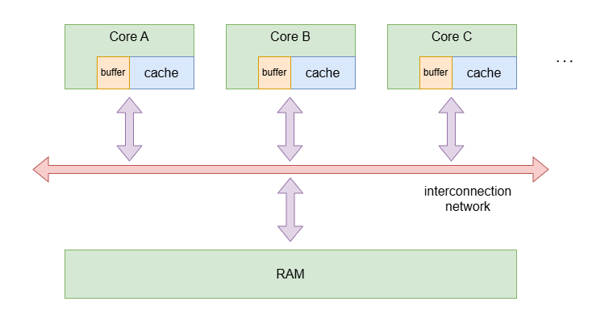
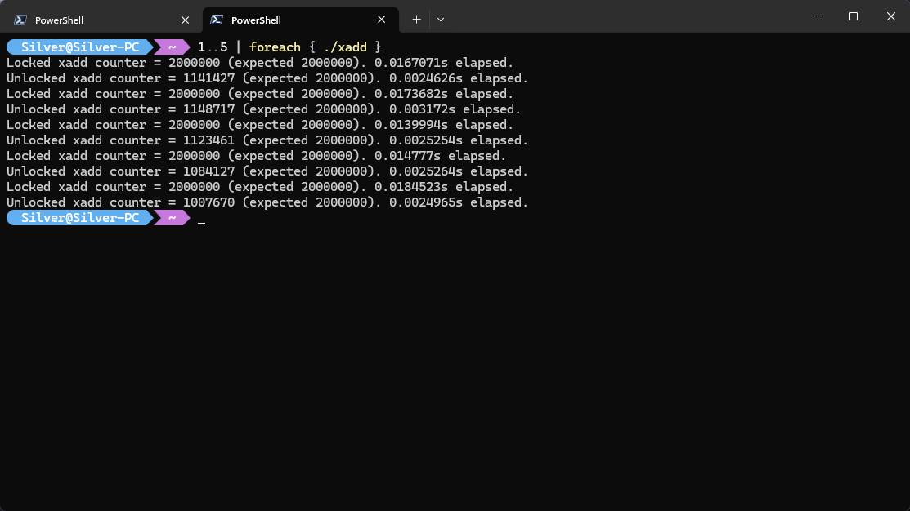

内存序（Memory Order）是在多线程环境下，不同线程对共享内存的访问次序的约定。

::: {.callout-important}
本文所谈到的内存均指广义上的内存（更严谨的叫法应该是主存，本文不做区分）而非狭义的 RAM，包含了 CPU 的寄存器、CPU cache、RAM、ROM、内存映射 I/O（Memory Mapped I/O, MMIO）、显示适配器其中需要特别说明的是 MMIO。

考虑一下，将一块 SATA 硬盘连接到主板后，CPU 怎样读写 SATA 硬盘？为了让 CPU 能够访问 SATA 硬盘这样的外存设备，外存设备会暴露一些端口，这些端口连接到设备内部的寄存器。每个寄存器具有不同的含义 [^atapi]，这其中最重要的是命令寄存器、数据寄存器、状态寄存器、地址寄存器三类寄存器。CPU 将设备的逻辑块地址（Logical Block Address, LBA）写入地址寄存器、将读命令写入命令寄存器后，SATA 硬盘读取数据后，将数据存入数据寄存器（一般为 2 字节），并设置状态寄存器。随后，CPU 从数据寄存器中取出数据，并清空状态寄存器，SATA 硬盘继续取出下一部分数据存入数据寄存器，并设置状态寄存器……如此循环往复，直到整个扇区（一般为 512 字节）的数据全部读出。这种最传统的操作磁盘的方式称作 PIO（Port I/O）模式，CPU 通过端口与硬件进行交互。现代的硬盘在此基础上还引入了各位或多或少都听说过的 DMA（Direct Memory Access）模式，通过合理的端口设置，硬盘可直接与物理内存进行数据传递，而无需浪费 CPU 时钟周期等待物理硬盘每条数据的读写操作完成。除了硬盘，显卡也是一种典型的 MMIO 设备，CPU 通过访问显卡暴露的寄存器来控制显卡的行为，比如设置显示模式、调整亮度、切换显示输出等。

[^atapi]: 可查阅 ATA/ATAPI 标准，该标准对寄存器的种类、行为等作出了规定。
    
对于用户态程序而言，寄存器、CPU cache、RAM 是其能够直接操作的设备，而 ROM、MMIO 则一般由操作系统内核统一管理，用户无权直接操作，必须通过系统调用来访问这些设备。
:::

## 一致性

在现代的 CPU 架构中，寄存器和内存之间除了 cache，还存在数据缓冲区。数据缓冲区根据功能的不同分为 store buffer、load buffer、branch buffer 等。在执行一条 store 指令时，数据先存入离寄存器更近的数据缓冲区，然后再写入 cache。Store buffer 类似于一个 FIFO 队列，CPU 流水线上可能存在着多条 store 指令，在执行过程中，待写数据先批量存入 store buffer，随后才批量写入 cache，提高执行效率。

{.center}

::: {.callout-note}
教科书中的经典总线模型是一个简化的模型，现代 CPU 实际上采用更复杂的链路实现 cache 与 cache 间、cache 与 RAM 间的通信，这类链路被统称为互连（interconnect）。由互连形成了一个分布式的通信网络，称为互连网络（interconnection network）。在互连网络中，允许多个核心发送的消息同时存在，这一特性会深刻影响后文介绍的内存序。
:::

一条 store 指令的执行如上所述被拆分为若干个阶段，各个 CPU 核心可能同时持有某一条内存数据的副本，当某个 CPU 核心执行 store 指令时，数据先存入 store buffer，再写入 cache，最后从 cache 写回主存。这个过程非常漫长，其他 CPU 核心在此期间若尝试访问该内存数据，就会造成数据竞争的问题。举例来说，线程 A 此时正在执行 store 指令，线程 B 正在执行 load 指令，线程 C 正在执行 store 指令，其操作数均为统一内存地址。在写者和读者之间，就存在数据不一致的问题；在两个写者之间，就存在数据覆盖的问题。这类问题统称为数据竞争（Data Race）。

这就牵扯出了多处理器并发场景下一个最为基础的问题——缓存一致性（cache coherency）：对于某个内存地址，_总是存在一个[能够]{.text-emphasize}被所有 CPU 核心观察到的全局的修改顺序（Total Modification Order, TMO）_，即对这个地址的修改操作存在严格的先后次序，不存在同时修改的情况，在任意时刻，这个内存地址处的值有且仅有一种状态。这里的内存地址，是一个逻辑上的地址，访问内存地址时，实际被访问到的物理内存设备可能不同——可能是 RAM，更有可能是分散在各个 CPU 核心中的 cache。另外需要特别注意的是**能够**一词，是指 CPU 应该具备这样一种能力——只要选用合适的指令，总是能够观察到全局修改顺序，但代价是更高的性能开销。是否观察、如何观察这样的全局修改顺序，就构成了后面要讨论的内存次序问题。一致性是任何 CPU 架构都必须满足的基本要求，否则就无法保证程序的正确性。

缓存一致性实际上意味着如下三条性质：

- 独占性（exclusivity）：同一时刻只能有一个 CPU 核心能够修改某个内存地址的数据。
- 完整性（integrity）：当一个 CPU 核心正在修改某个内存地址的数据时，其他 CPU 核心无法观察到这个内存地址的数据处于不完整的状态。即其他 CPU 核心要么观察到旧值，要么观察到新值，不可能观察到部分修改的值。
- 可见性（visibility）：一旦一个 CPU 完成了对某个内存地址处的数据的修改，随后其他的 CPU 核心在观察这个内存地址的数据时，观察到的值**一定**是新值，这一点由缓存一致性协议保证。

::: {.callout-note}
在 MESI 协议 [^protocol] 下，CPU cache 中的数据被划分为 Modified、Exclusive、Shared 和 Invalid 四种状态：

- Modified：表示该 cache 行的数据已经被修改过了，并且与主存中的数据不一致。
- Exclusive：表示该 cache 行的数据与主存中的数据一致，并且只有当前 CPU 核心拥有该 cache 行的副本。
- Shared：表示该 cache 行的数据与主存中的数据一致，并且有多个 CPU 核心拥有该 cache 行的副本。
- Invalid：表示该 cache 行的数据无效。
  
[^protocol]: 缓存一致性协议有 MSI、MESI、MEOSI 三种，感兴趣可自行查阅资料。现代 CPU 的缓存一致性协议远比上述三种协议更为复杂，MESI 协议仅作为一个简化的模型来说明问题。

在现代的 CPU 中，cache miss 发生时，CPU 通过总线尝试从主存中加载数据。同时，其他 CPU 核心会保持对总线的嗅探（snooping），检查是否存在对已缓存数据的访问。假定此时另一 CPU 核心发现总线请求的地址已经被缓存，且对应的 cache line 处于 Exclusive 状态，那么该 CPU 核心会直接将总线请求的数据提供给发起请求的 CPU 核心，而不需要从主存中加载数据。
:::

缓存一致性是针对指令执行的效果而言的，对于任何处理器，缓存一致性是最为基本的要求。而对于指令执行这个过程本身，还有一个重要的概念——不可分割性（indivisibility）。一条指令的执行过程可进一步细分为若干阶段，尤以 x86 为代表的复杂指令集架构为甚，单条指令被拆分为若干微操作（μOPs）执行。**不论指令如何拆分，一条不可分割的指令从作用效果上来看，应该确保其他 CPU 核心只能观察到执行前和执行后两个状态，而不允许观察到部分执行的状态。**
我们不妨尝试从**从数据一致性**的角度界定指令开始和结束的边界，以便理解上述问题。以前面提到的 store 指令为例，当数据写入 store buffer 时，待写入的数据准备就绪，可认为 store 指令执行开始，这时，当前 CPU 核心会向其他 CPU 核心发送失效消息，其他 CPU 核心收到该失效消息后，会将相关的 cache 行标记为无效并向当前 CPU 核心发送确认消息 [^ideal]。随后，数据从 store buffer 传输到 cache 中，可认为 store 指令执行结束（写回 RAM 只在必要时才进行，因此除非发生 cache miss，否则整个过程与 RAM 无关）。需要指出，这里的“开始”和“结束”是从维护数据一致性的角度界定的，执行 store 指令本身需要经过取指、译码以及最后从 cache 写回主存的阶段，我们仅考虑其中与数据一致性相关的部分。在这个过程中，其他 CPU 核心无法观察 store 操作地址的数据状态，确保整个 store 指令操作不可分割。

[^ideal]: 这是一个简化的理想模型，真实 CPU 中维护数据一致性的机制更为复杂。

不难看出，缓存一致性和指令不可分割性是深度绑定的概念，这两个概念合在一起，就是所谓的原子性（atomicity）。原子性保证了在多处理器并发环境下，在其他处理器核心看来，当前核心上一条原子指令的执行效果是不可分割的，即要么没有执行，要么执行结束，不会出现部分执行的情况。并且对于其他观察者来说，指令的执行效果是要么完全可见，要么完全不可见的。原子性是多处理器并发环境下保证数据一致性的基础，也是后续讨论内存序问题的前提条件。对于所有的 CPU 架构，缓存一致性是必须满足的，但指令不可分割性则未必满足，其中最典型的例子是 x86 中的 `xadd` 指令在未加 `lock` 前缀的情况下就会被正常分割为 load、add、store 三条指令执行，并且不提供中间过程的隐藏保证，即其他 CPU 核心可以观察到 `xadd` 指令的部分执行状态，这时就不满足原子性的要求了，我们在下一小节将继续深入探讨这个问题。总之，在 CPU 硬件的层面，由于缓存一致性始终满足，故原子性就等同于指令执行的不可分割性。

## 内存序

前面提到，在 CPU 流水线上的若干条 store 指令会先将数据批量存入 store buffer，随后才批量写入 cache。类似这样的优化会导致一个核心执行了一条指令，但这条指令的效果对于其他核心来说并不是立即可见的。对于单线程程序而言，指令的执行顺序是完全确定的，尽管存在可能的乱序执行，指令的执行效果对于单线程而言的顺序就是指令的编写顺序。举例来说，单线程中执行 store 后立即执行 load，load 的值必须是刚才 store 的值。任何处理器都在单线程环境下都必须满足此要求，若达不到这个要求，并发的正确性就无从谈起。我们自然而然地认定这样的顺序就是正确的顺序。只要其他线程观察到的执行顺序与这个顺序一致，那么程序的行为就是正确的。满足这种顺序要求的内存序被称为顺序一致性（sequential consistency）。顺序一致性符合直觉，但与性能优化相冲突。为了实现这种正确性和性能的平衡，现代 CPU 引入了内存序的概念，C++ 11 将不同处理器平台的内存序抽象成了下面 6 种：

- `std::memory_order_relaxed`{.language-cpp}
- `std::memory_order_consume`{.language-cpp}
- `std::memory_order_acquire`{.language-cpp}
- `std::memory_order_release`{.language-cpp}
- `std::memory_order_acq_rel`{.language-cpp}
- `std::memory_order_seq_cst`{.language-cpp}

每种内存序对正确性提出了不同程度的要求，不严谨地讲，一种特定的处理器平台所支持的内存序是这 6 种内存序的一个子集。除了硬件层面的顺序约定，上述 6 种内存序还对编译器的优化行为提出了不同的要求。编译器在进行指令重排等优化时，必须遵守内存序的约束，以确保程序的正确性。

### relaxed 内存序

> `std::memory_order_relaxed`
>
> Relaxed operation: There are no synchronization or ordering constraints imposed on other reads or writes, only this operation's atomicity is guaranteed.

`std::memory_order_relaxed`{.language-cpp} 是 C++ 11 中内存序要求最低的内存序，其本质就是原子操作。如前文所述，原子操作保证了数据的一致性和指令的不可分割性，但并没有保证指令的执行顺序。由于所有的 CPU 都必须满足数据一致性，此外像 load、store 这类基础的指令天然就应具备不可分割性。因此，市面主流的 CPU 架构的 load、store 指令都满足 `std::memory_order_relaxed`{.language-cpp} 的要求。不过，不满足不可分割性的指令也是存在的，比如 x86 中的 `xadd` 指令在未加 `lock` 前缀的情况下就会被分割为 load、add、store 三条指令执行，这时就不满足 `std::memory_order_relaxed`{.language-cpp} 的要求了，请看下例：

::: {.callout-tip}
`xadd r/m, r` 将 `r/m` 与 `r` 进行交换，并将 `r` 的值加到 `r/m` 上。这样，`r` 中就保存了 `r/m` 的原值。这一特性非常重要，指令的调用方可以在执行原子加法后得知被加数的原值，从而实现一些特殊的算法。
:::

```cpp
#include <chrono>
#include <thread>
#include <iostream>

alignas(64) std::uint64_t unlocked_counter = 0;
alignas(64) std::uint64_t locked_counter = 0;

void worker_locked(std::uint64_t iters) {
    for (std::uint64_t i = 0; i < iters; i++) {
        __asm {
            mov eax, 1
            lock xadd dword ptr locked_counter, eax
        }
    }
}

void worker_unlocked(std::uint64_t iters) {
    for (std::uint64_t i = 0; i < iters; i++) {
        __asm {
            mov eax, 1
            xadd dword ptr unlocked_counter, eax
        };
    }
}

int main() {
    std::uint64_t iters = 1'000'000;
    const auto start1{ std::chrono::steady_clock::now() };
    std::thread t1(worker_locked, iters);
    std::thread t2(worker_locked, iters);
    t1.join();
    t2.join();
    const auto end1{ std::chrono::steady_clock::now() };
    const std::chrono::duration<double> elapsed1{ end1 - start1 };
    std::cout << "Locked xadd counter = " << locked_counter
              << " (expected " << 2 * iters << "). "
              << elapsed1.count() << "s " << "elapsed." << std::endl;
    const auto start2{ std::chrono::steady_clock::now() };
    std::thread t3(worker_unlocked, iters);
    std::thread t4(worker_unlocked, iters);
    t3.join();
    t4.join();
    const auto end2{ std::chrono::steady_clock::now() };
    const std::chrono::duration<double> elapsed2{ end2 - start2 };
    std::cout << "Unlocked xadd counter = " << unlocked_counter
              << " (expected " << 2 * iters << "). "
              << elapsed2.count() << "s " << "elapsed." << std::endl;
}
```

使用 `clang++ -fms-extensions xadd.cpp -o xadd.exe`{.language-powershell} 编译后运行若干次：

{.center}

::: {.callout-warning}
代码中，`alignas(64)`{.language-cpp} 是为了避免伪共享（false sharing）问题，确保 `unlocked_counter` 和 `locked_counter` 按照 64 字节对齐，使其分别占用独立的 cache 行（64 字节）。若不加 `alignas(64)`{.language-cpp}，变量就有可能被拆分到两个 cache 行中。在这种情况下，cache 的更新就会被割裂成两次，cache 行会被锁定更长时间，导致性能下降。
:::

`std::memory_order_relaxed` 的另一作用是约束编译器可能的优化。针对高级语言，`std::memory_order_relaxed`{.language-cpp} 还要求原子操作**最终**的可见性（visibility），即一个线程修改了某变量后，其他线程能够观察到这个修改。

```cpp
int data = 0;

void thread1() {
    data = 1;
    // do something
    data = 2;
}

void thread2() {
    while (data != 1) { // never fires
        // do something
    }
}
```

开启 -O2 优化后，clang++ 18.1.3 为 `thread1` 生成了如下的汇编代码：

```nasm
mov    DWORD PTR [rip+0x0],0x2
ret
nop    DWORD PTR [rax+rax*1+0x0]
```

可以看到，`thread1` 中的两条赋值语句被合并成了一条赋值语句，这就导致了 `thread2` 永远无法观察到 `data == 1`。

若将 `data` 定义为 `std::atomic_int`，并且在 `thread1` 中的两条赋值语句后面都加上 `std::memory_order_relaxed`，上面的问题就能够得到解决。

:::: { .columns }
::: { .column width="50%" }
```cpp
#include <atomic>

std::atomic_int data = 0;

void thread1() {
    data.store(1, std::memory_order_relaxed);
    // do something
    data.store(2, std::memory_order_relaxed);
}
```
:::
::: { .column width="50%" }
引入 `std::memory_order_relaxed` 后，clang++ 18.1.3 为 `thread1` 生成了如下的汇编代码，可以看到，`thread1` 中的两条赋值语句被保留了下来：

```nasm
mov    DWORD PTR [rip+0x0],0x1
mov    DWORD PTR [rip+0x0],0x2
ret
data16 cs nop WORD PTR [rax+rax*1+0x0]
```
:::
::::

### relaxed 内存序存在的问题

首先给出下面的一个例子：

```cpp
std::atomic_bool flag{ false };
int data{ 0 };

void thread1() { // running on CPU#1
    // access to flag, flag now cached and exclusive in CPU#1
    data = 1; // I1
    flag.store(true, std::memory_order_relaxed); // I_2
}

void thread2() { // running on CPU#2
    while (!flag.load(std::memory_order_relaxed)) continue; // I_3
    assert(data == 1); // I_4, may fail
}
```

即便使用了原子操作，`thread1` 中的两条 store 指令的先后顺序是没有保证的。假定此时缓存状态如下：

- CPU#1 cache：`flag`（Exclusive）
- CPU#2 cache：`data`（Exclusive）

这时，考虑如下执行顺序：

1. CPU#1 执行 $I_{1}$。这是一条 store 指令，虽然 CPU#1 目前没有缓存 `data`，但只要确保其他核心没有缓存 `data`，就可以直接执行 store。为此，CPU#1 向其他 CPU 核心发送 `data` 失效消息，并将 `1` 存入 store buffer，但并不立即写入 cache，只有等到所有 CPU 核心都确认了 `data` 的失效后，才将 `1` 写入 cache 中。
2. CPU#2 执行 $I_{3}$。发送对 `flag` 的 load 请求。
3. CPU#1 执行 $I_{2}$。由于 `flag` 已经被 CPU#1 缓存并且处于独占状态，因此 `flag` 的 store 操作可以直接写入缓存，并由 Exclusive 迁移到 Modified 状态，而无需等待其他 CPU 核心的确认。
4. CPU#1 收到 CPU#2 的 load 请求后，向 CPU#2 发送 `flag` 的最新值 `true`，并将状态标记为 Shared。
5. CPU#2 收到 `flag` 的最新值 `true` 后，在缓存中添加 `flag` 的副本，并将状态标记为 Shared。
6. CPU#2 执行 $I_{4}$。由于此时 `data` 已经被缓存，且处于 Exclusive 状态，因此 CPU#2 直接从 cache 中读取 `data` 的值，此时 `data` 的值仍然是 `0`，导致 $I_{4}$ 断言失败。
7. CPU#2 收到 `data` 的失效消息。`data` 的 cache 行标记为 Invalid，并向 CPU#1 发送确认消息。
8. CPU#1 收到 CPU#2 的确认消息后，将 `1` 从 store buffer 写入 cache 中，并将 `data` 的 cache 行状态置为 Exclusive。
9. $\cdots$

::: {.callout-note}
CPU 互连网络中的消息到达时刻不存在次序保证。即便 CPU#1 先发送失效消息，CPU#2 后发送请求消息，但 CPU#2 的请求消息仍可能先到达 CPU#1。
:::

可以看到，`thread1` 中的两条 store 指令执行效果**可见顺序**对 `thread2` 来说是没有保证的。

::: {.callout-important}
- 具有 relaxed 内存序的原子指令所保证的顺序是针对其所操作的内存地址而言的，它保证对一个内存地址执行原子操作后，后续的其他线程一定能够观察到这个内存地址的最新值。
- 排布在 relaxed 内存序的原子指令周围的指令的可见性顺序无法得到保证（除非这些指令本身对内存序提出了要求），其他线程观察到的这些指令的执行顺序可能与程序中编写的顺序不一致。
:::

不同的 CPU 架构对于内存序的保证程度不同，x86 架构下，所有的 load 和 store 操作都是原子的，并且 store 操作符合后文要介绍的顺序一致性（sequential consistency），即在任何线程看来 `data` 的更新一定发生在 `flag` 之前，因此在 x86 下永远不会观察到上述情况。而 ARM64 架构则不提供这样的顺序一致性保证，因此上述代码中 `thread1` 中的两条 store 指令的先后顺序是没有保证的。上面的例子中，CPU#2 所观察到的 `flag` 和 `data` 的确只存在旧和新两种状态，也就是说，原子性是满足的。但 CPU#2 观察到的更新顺序却与实际的顺序相反。也就是说，原子性无法保证**可见顺序**。

为了解决上述问题，现代 CPU 引入了内存屏障（memory barrier）。现代 CPU 提供了一套专门的指令来实现内存屏障的功能。内存屏障指令用于约束 CPU 执行指令的顺序，确保在内存屏障之前的指令执行彻底完成后，才会执行内存屏障之后的指令。C++ 11 引入了 `std::atomic_thread_fence`，可通过选用不同的内存序，控制编译器使用不同类型的内存屏障指令。
除了专门的内存屏障指令，部分原子指令也能够起到内存屏障的效果。

::: {.callout-note}
**完备性问题**

原子指令同样能够起到内存屏障的效果，为什么还需要单独的内存屏障指令呢？这个问题可从三个角度回答：

- 原子指令的内存屏障的效果仅对用户态程序成立。开篇提到，内存除了常见的寄存器、RAM、cache，还包括 ROM 和 MMIO。原子变量从硬件视角来看存在于 cache 和 RAM 中，因此原子指令的内存屏障效果仅对 cache 和 RAM 成立。MMIO 设备虽然也通过内存地址访问，但这种内存的本质是设备寄存器。访问 RAM 会造成 cache 行的更新，但 MMIO 不会，其机理完全不同，对 MMIO 地址执行原子指令，其行为是未定义的。因此，原子指令的内存屏障效果对于 MMIO 是不成立的。但内存屏障指令则是直接作用于 CPU 的指令执行顺序的，因此对于 MMIO 也是有效的。
- 内存屏障在有些情况能够提供更好的性能（见后文例子）。
- 原子指令的内存屏障效果与单一内存屏障指令所能提供的内存屏障效果并不等价。在后面会看到，大部分情况下，带特定内存序的原子指令很多时候相当于在 relaxed 原子指令 + 特定内存序的内存屏障指令的组合。但也存在一些情况，特定内存序的原子指令所提供的内存屏障效果要比单一内存屏障指令更强（见后文例子）。
:::

### release 内存序

上面的例子错误的根源是 CPU#1 在等待缓存一致性协议的确认过程中，仍可以继续执行后续的 store 指令。由于 CPU 并不知道两次 store 的数据在逻辑上的相关性，因此在其他线程看来，这两次 store 的可见顺序无法得到保证。
为了解决 relaxed 内存序存在的问题，可以使用 release 内存序，用于显示地告知 CPU 可能存在的数据关联。

> `std::memory_order_release`
>
> A store operation with this memory order performs the release operation: no reads or writes in the current thread can be reordered after this store. All writes in the current thread are visible in other threads that acquire the same atomic variable (see Release-Acquire ordering below) and writes that carry a dependency into the atomic variable become visible in other threads that consume the same atomic.

release 内存序限定 store 的行为，当一个线程执行具有 release 内存序的 store 操作时，CPU 会确保在该 store 操作之前的所有内存操作都已经完成，并且在该 store 操作之后的内存操作不会被重排到该 store 操作之前。使用 `std::memory_order_release`{.language-cpp} 后，CPU#1 在执行具有 release 内存序的 $I_{2}$ 时，由于 store buffer 存在尚未完成的操作，而是先标记在此操作之前在 store buffer 中的所有未完成的操作，然后将 `flag` 的值暂存到 store buffer 中（不做标记）。等到收到其他核心发送的确认消息后，才将 store buffer 中未标记数据写入 cache 中。因此，当 $I_{2}$ 操作的结果可见时，$I_{1}$ 操作的结果也一定可见了。

```cpp
void thread1() { // running on CPU#1
    data = 1; // I_1
    flag.store(true, std::memory_order_release); // I_2
}
```

我们仍假定缓存状态如下：

- CPU#1 cache：`flag`（Exclusive）
- CPU#2 cache：`data`（Exclusive）

引入 release 内存序后，执行情况如下：

1. CPU#1 执行 $I_{1}$，发送 `data` 读后失效消息，并将 `1` 暂存到 store buffer。
2. CPU#2 执行 $I_{3}$，由于 `flag` 未被缓存，发送一条消息请求 `flag`。
3. CPU#1 执行 $I_{2}$，由于 store buffer 中存在尚未完成的操作，因此先标记在此操作之前在 store buffer 中的所有未完成的操作，然后将 `flag` 的新值 `true` 暂存到 store buffer 中（不做标记）。
4. CPU#1 收到 CPU#2 的 load 请求后，向 CPU#2 发送 `flag` 的当前值 `false`，并将状态标记为 Shared。
5. CPU#2 收到 `flag` 的值 `false` 后，在缓存中添加 `flag` 的副本，并将状态标记为 Shared。
6. CPU#2 继续执行 $I_{3}$。
7. CPU#2 收到来自 CPU#1 的 `data` 读后失效消息，将 `data` 的值通过消息发送给 CPU#1，并将 `data` 所在缓存行的状态设置为 Invalid。
8. CPU#1 收到 CPU#2 的确认消息后，将暂存在 store buffer 中的 `data` 新值 `1` 同步到 cache 中，并标记为 Modified。
9. 由于 CPU#1 的 store buffer 中已标记的暂存数据清空，CPU#1 随后尝试将暂存在 store buffer 中的 `flag` 新值 `true` 同步到 cache 中，但由于此时 `flag` 所在 cache 行处于 Shared 状态，无法更新，因此 CPU#1 发送 `flag` 失效消息。
10. CPU#2 收到 `flag` 失效消息，将 `flag` 所在 cache 行标记为 Invalid，并向 CPU#1 发送确认。
11. CPU#2 继续执行 $I_{3}$，但 `flag` 当前已经失效，因此 CPU#2 发送一条消息请求 `flag` 的值。
12. CPU#1 收到确认，随机将 cache 中的 `flag` 更新为 store buffer 中的新值 `true`，并将其标记为 Modified。
13. CPU#1 收到对 `flag` 的请求，将 `true` 通过消息发送给 CPU#2，并将 `flag` 所在 cache 行标记为 Shared Modified。
14. CPU#2 收到 `flag` 的值 `true`，在缓存中添加 `flag` 的副本，并将状态标记为 Shared。
15. CPU#2 执行 $I_{4}$，由于此时 `data` 处于 Invalid 状态，因此 CPU#2 发送一条读消息请求 `data` 的值。
16. CPU#1 收到 `data` 读消息，向 CPU#2 提供 `data` 的最新值 `1`，`data` 所在缓存行变更为 Shared Modified。
17. CPU#2 收到 `data` 的最新值 `1`，将其加入缓存，状态置为 Shared。$I_{4}$ 断言随后通过。

::: {.callout-tip}
我们可以使用内存屏障做到相同的事情：

```cpp
int data;
int flag;

void thread1() { // running on CPU#1
    data = 1;
    std::thread_memory_fence(std::memory_order_release);
    flag = 1;
}
```

这时 `flag` 就不一定需要是一个原子变量了。这是由于：

- 内存屏障同样起到了约束编译器优化的效果。
- 对 `flag` 执行基础的 store 操作本身就符合原子性要求，因此不需要使用原子指令来保证原子性了。

需要指出，只有基础的 load 和 store 指令才满足原子性要求，其他指令（如 x86 中的 `xadd`）则不满足原子性要求。例如：

```cpp
int data;
int counter;

void thread1() { // running on CPU#1
    data = 1;
    std::thread_memory_fence(std::memory_order_release);
    counter++; // alert: not atomic!
}
```

这种情况下，仍必须将 `counter` 定义为一个原子变量，并使用原子操作实现 `counter++`，内存序至少是 relaxed 内存序：

```cpp
int data
std::atomic_int counter;

void thread1() { // running on CPU#1
    data = 1;
    std::thread_memory_fence(std::memory_order_release);
    counter.fetch_add(1, std::memory_order_relaxed); // at least relaxed memory order
}
```

在 x86 平台上，具有 relaxed 内存序的 `fetch_add` 会被编译成 `lock xadd` 指令。
:::

### release 内存序的局限性

CPU 核心处理失效消息的速度显著慢于其他类型消息的速度。处理失效消息的过程涉及到多个阶段，包括将相关的 cache 行标记为无效、向其他 CPU 核心发送确认消息等，这些操作都需要一定的时间来完成。
假定当前 CPU 核心数据吞吐量非常大，此时 cache 非常繁忙，而恰好 CPU 收到了一条失效消息。若 CPU 必须立即处理这条失效消息，将会造成其他 CPU 核心产生更多的 stalls，导致性能下降。现代 CPU 采取的做法是引入消息队列来缓存收到的消息。当前 CPU 核心收到失效消息后，并不立即处理，而是将其加入专门存放失效消息的队列（invalidate queue，后文译作失效队列）
中，并且立即向其他核心发送确认消息，等到 cache 空闲时再处理失效消息，失效队列的存在也会影响到可见顺序。

release 内存序确保了写者线程中 release 操作及其之前的操作的可见性，但在引入失效队列后，读者线程若仍使用 `std::memory_order_relaxed` 读取 `flag`，随后执行的 `data` 仍有可能读取到旧值。

```cpp
std::atomic_bool flag{ false };
int data{ 0 };

void thread1() { // running on CPU#1
    data = 1; // I_1
    flag.store(true, std::memory_order_release); // I_2
}

void thread2() { // running on CPU#2
    while (!flag.load(std::memory_order_relaxed)) continue; // I_3
    assert(data == 1); // I_4, may fail
}
```

假定此时缓存状态如下：

- CPU#1：`flag`（Exclusive）、`data`（Shared）
- CPU#2：`data`（Shared）

1. CPU#1 执行 $I_{1}$，由于 `data` 已经被 CPU#1 缓存并且处于 Shared 状态，因此 CPU#1 向其他核心发送 `data` 的失效消息，并将 `1` 存入 store buffer，但并不立即写入 cache，只有等到所有 CPU 核心都确认了 `data` 的失效后，才将 `1` 写入 cache 中。
2. CPU#1 执行 $I_{2}$，由于 store buffer 中存在尚未完成的操作，因此先标记在此操作之前在 store buffer 中的所有未完成的操作，然后将 `flag` 的新值 `true` 暂存到 store buffer 中（不做标记）。等到收到其他核心发送的确认消息后，才将 store buffer 中未标记数据写入 cache 中。
3. CPU#2 收到 CPU#1 发送的 `data` 失效消息，将失效消息添加到失效队列，并立即向 CPU#1 发送确认消息。
4. CPU#2 执行 $I_{3}$，发送对 `flag` 的 load 请求。
5. CPU#1 收到 CPU#1 发送的确认消息后，将 store buffer 中的 `data` 新值 `1` 同步到 cache 中，并标记为 Modified Exclusive。Cache 中的 `flag` 随即更新为 store buffer 中的新值 `true`，并将其标记为 Modified。
6. CPU#1 收到 CPU#2 的 load 请求后，向 CPU#2 发送 `flag` 的当前值 `true`，并将状态标记为 Modified Shared。
7. CPU#2 收到 `flag` 的值 `true` 后，在缓存中添加 `flag` 的副本，并将状态标记为 Shared。
8. CPU#2 执行 $I_{4}$，由于此时 `data` 仍处于 Shared 状态，因此 CPU#2 直接从 cache 中读取 `data` 的值，此时 `data` 的值仍然是 `0`，导致 $I_{4}$ 断言失败。
9. CPU#2 处理失效队列中的 `data` 失效消息，将 `data` 的 cache 行标记为 Invalid，但已经无法阻止 $I_{4}$ 读取到旧值了。

可以看到，即便写者线程中的 release 操作及其之前的操作的可见性得到了保证，但读者线程仍有可能观察到 release 操作之前的操作的旧值。这是由于失效队列的存在导致的。为了解决这个问题，读者线程需要告知 CPU `flag` 和 `data` 之间的依赖关系。本质上，就是要求 CPU#2 在读取 `data` 之前，先清空失效队列中的消息，确保 `data` 的 cache 行的状态是最新的，这就引出了与 release 内存序配套的 acquire 内存序。

> `std::memory_order_acquire`
>
> A load operation with this memory order performs the acquire operation on the affected memory location: no reads or writes in the current thread can be reordered before this load. All writes in other threads that release the same atomic variable are visible in the current thread.

```cpp
void thread2() { // running on CPU#2
    while (!flag.load(std::memory_order_acquire)) continue; // I_3
    assert(data == 1); // I_4, guaranteed to pass
}
```

假定此时缓存状态如下：

- CPU#1：`flag`（Exclusive）、`data`（Shared）
- CPU#2：`data`（Shared）

我们再来审视一下上述代码的执行情况：

1. CPU#1 执行 $I_{1}$，由于 `data` 已经被 CPU#1 缓存并且处于 Shared 状态，因此 CPU#1 向其他核心发送 `data` 的失效消息，并将 `1` 存入 store buffer，但并不立即写入 cache，只有等到所有 CPU 核心都确认了 `data` 的失效后，才将 `1` 写入 cache 中。
2. CPU#1 执行 $I_{2}$，由于 store buffer 中存在尚未完成的操作，因此先标记在此操作之前在 store buffer 中的所有未完成的操作，然后将 `flag` 的新值 `true` 暂存到 store buffer 中（不做标记）。等到收到其他核心发送的确认消息后，才将 store buffer 中未标记数据写入 cache 中。
3. CPU#2 收到 CPU#1 发送的 `data` 失效消息，将失效消息添加到失效队列，并立即向 CPU#1 发送确认消息。
4. CPU#2 执行 $I_{3}$，发送对 `flag` 的 load 请求。
5. CPU#1 收到 CPU#1 发送的确认消息后，将 store buffer 中的 `data` 新值 `1` 同步到 cache 中，并标记为 Modified Exclusive。Cache 中的 `flag` 随即更新为 store buffer 中的新值 `true`，并将其标记为 Modified。
6. CPU#1 收到 CPU#2 的 load 请求后，向 CPU#2 发送 `flag` 的当前值 `true`，并将状态标记为 Modified Shared。
7. CPU#2 收到 `flag` 的值 `true` 后，在缓存中添加 `flag` 的副本，并将状态标记为 Shared。
8. CPU#2 等待失效队列中的消息被处理完毕，CPU#2 处理失效队列中的 `data` 失效消息，将 `data` 的 cache 行标记为 Invalid。
9. CPU#2 继续执行 $I_{4}$，由于此时 `data` 已经被标记为 Invalid，因此 CPU#2 发送一条消息请求 `data` 的值。
10. CPU#1 收到 `data` 读消息，向 CPU#2 提供 `data` 的最新值 `1`，状态变更为 Modified Shared。
11. CPU#2 收到 `data` 的最新值 `1`，将其加入缓存，状态置为 Shared。$I_{4}$ 断言随后通过。

::: {.callout-tip}
读者可能意识到上述代码可能存在的性能开销问题，我们在每一次执行 $I_{3}$ 时都要等待失效队列中的消息被处理完毕。实际上，我们只需要确保失效队列清空发生在 $I_{4}$ 之前就可以了，我们可以采用内存屏障来优化性能：

```cpp
int data{ 0 };
bool flag{ false };

void thread1() { // running on CPU#1
    data = 1; // I_1
    std::thread_memory_fence(std::memory_order_release);
    flag = true; // I_2
}

void thread2() { // running on CPU#2
    while (!flag) continue; // I_3
    std::thread_memory_fence(std::memory_order_acquire);
    assert(data == 1); // I_4, guaranteed to pass
}
```

所以，内存屏障另一个重要的作用就是实现比纯原子操作更细粒度的内存序要求，从而在保证正确性的前提下，提升性能。
:::

### 被废弃的 consume 内存序

> `std::memory_order_consume`{.language-cpp}
>
> A load operation with this memory order performs a consume operation on the affected memory location: no reads or writes in the current thread dependent on the value currently loaded can be reordered before this load. Writes to data-dependent variables in other threads that release the same atomic variable are visible in the current thread. On most platforms, this affects **compiler optimizations** only.

除了 acquire 内存序，C++ 11 还引入了 consume 内存序，consume 内存序的语义与 acquire 内存序类似，但它的约束范围更小，仅仅对相关的数据在保证原子性的基础上限制了编译器的指令重排，换句话说，在硬件层面，编译器生成的代码仍是一条普通的 relaxed 原子指令。Consume 主要是尝试在 acquire 内存序的基础上减少现在进一步提升性能。然而，在之前介绍 acquire 内存序的小节中，我们实际上已经注意到采用 relaxed 内存序读取以 release 内存序写入的变量时，读者线程仍有可能观察到 release 内存序之前的操作的旧值。因此，这个内存序的实际定位，在 C++ 26 标准中，consume 内存序被废弃了。

#### acquire-release 内存序

> `std::memory_order_acq_rel`
>
> A read-modify-write operation with this memory order is both an acquire operation and a release operation. No memory reads or writes in the current thread can be reordered before the load, nor after the store. All writes in other threads that release the same atomic variable are visible before the modification and the modification is visible in other threads that acquire the same atomic variable.

Acquire-release 内存序是 acquire 内存序和 release 内存序的组合，适用于那些既需要保证前续操作的可见性，又需要保证后续操作的可见性的场景。对于 acquire-release 内存序的原子指令来说，其 load 部分具有 acquire 内存序的语义，而 store 部分具有 release 内存序的语义，因此 acquire-release 内存序的原子指令在执行时会同时满足 acquire 内存序和 release 内存序的约束。

CPU 除了提供基础的 load 和 store 指令，还提供了一些同时具备 load 和 store 功能的指令，这些指令被称为读-改-写（read-modify-write）指令。之前提到的 x86 `xadd` 指令就是一例，除了修改目标操作数，源操作数中还加载了目标操作数修改前的原值。

C++ 使用 `fetch_add` 和 `fetch_sub` 封装了读-改-写指令，并且允许开发者为其指定内存序。对于 `fetch_add` 和 `fetch_sub` 来说，若需要使用目标操作数修改前的原值，就需要用到 acquire-release 内存序，以同时满足先前操作和后续操作的可见性要求。

```cpp
std::atomic_int counter{ 0 };
constexpr int threshold{ 100 };

void producer() {
    int old_value = counter.fetch_add(1, std::memory_order_acq_rel);
    if (old_value == threshold - 1) {
        // do something
    }
}

void consumer() {
    int old_value = counter.fetch_sub(1, std::memory_order_acq_rel);
    if (old_value == 1) {
        // do something
    }
}
```

### sequentially-consistent 内存序

> `std::memory_order_seq_cst`
>
> A load operation with this memory order performs an acquire operation, a store performs a release operation, and read-modify-write performs both an acquire operation and a release operation, plus a single total order exists in which all threads observe all modifications in the same order.

有了 acquire 内存序和 release 内存序，看起来我们已经能够满足大部分的内存序要求了，那么为什么 C++ 11 还要引入 sequentially-consistent 内存序呢？sequentially-consistent 内存序（后文译作顺序一致性）是 C++ 11 中内存序要求最高的内存序，除了满足 acquire 内存序和 release 内存序的约束外，还要求所有线程观察到的修改顺序是一致的。我们仍然举一个例子来说明为什么 acquire 内存序和 release 内存序无法解决所有的内存序问题：

```cpp
std::atomic_int x{ 0 }, y{ 0 };

void thread1() {
    x.store(1, std::memory_order_release); // I_1
    int r1 = y.load(std::memory_order_acquire); // I_2
}

void thread2() {
    y.store(1, std::memory_order_release); // I_3
    int r2 = x.load(std::memory_order_acquire); // I_4
}
```

假定此时缓存状态如下：

- CPU#1：`x`（Shared）、`y`（Shared）
- CPU#2：`x`（Shared）、`y`（Shared）

考虑如下执行顺序：

1. CPU#1 执行 $I_{1}$，由于 `x` 已经被 CPU#1 缓存并且处于 Shared 状态，因此 CPU#1 向其他核心发送 `x` 的失效消息，并将 `1` 存入 store buffer，但并不立即写入 cache，只有等到所有 CPU 核心都确认了 `x` 的失效后，才将 `1` 写入 cache 中。
2. CPU#1 执行 $I_{2}$，由于 `y` 已经被 CPU#1 缓存并且处于 Shared 状态，因此 CPU#1 直接从 cache 中读取 `y` 的值，此时 `y` 的值仍然是 `0`，因此 $I_{2}$ 读取到的值为 `0`。
3. CPU#2 执行 $I_{3}$，由于 `y` 已经被 CPU#2 缓存并且处于 Shared 状态，因此 CPU#2 向其他核心发送 `y` 的失效消息，并将 `1` 存入 store buffer，但并不立即写入 cache，只有等到所有 CPU 核心都确认了 `y` 的失效后，才将 `1` 写入 cache 中。
4. CPU#2 执行 $I_{4}$，由于 `x` 已经被 CPU#2 缓存并且处于 Shared 状态，因此 CPU#2 直接从 cache 中读取 `x` 的值，此时 `x` 的值仍然是 `0`，因此 $I_{4}$ 读取到的值为 `0`。
5. CPU#1 收到 CPU#2 发送的 `y` 失效消息，将 `y` 的 cache 行标记为 Invalid，并向 CPU#2 发送确认消息。
6. CPU#2 收到 CPU#1 发送的确认消息后，将 `y` 的新值 `1` 同步到 cache 中，并标记为 Modified。
7. CPU#2 收到 CPU#1 发送的 `x` 失效消息，将 `x` 的 cache 行标记为 Invalid，并向 CPU#1 发送确认消息。
8. CPU#1 收到 CPU#2 发送的确认消息后，将 `x` 的新值 `1` 同步到 cache 中，并标记为 Modified。

上面的执行顺序导致一个这样的结果：`r1 == 0 && r2 == 0`{.language-cpp}。也就是说，两个线程都没有观察到对方的更新。从顺序一致性的角度来看：

- `r1 == 0`{.language-cpp} 意味着 $I_2 \prec I_3$。[^prec]
- `r2 == 0`{.language-cpp} 意味着 $I_4 \prec I_1$。
- release 内存序要求 $I_1 \prec I_2$ 和 $I_3 \prec I_4$。

因此，以上的执行顺序导致了一个矛盾的全局顺序：$I_1 \prec I_2 \prec I_3 \prec I_4 \prec I_1$。那么，为什么这样的事情会发生呢？我们再回过头看指令的执行过程，在 CPU#1 执行 $I_{1}$ 时，仅仅是简单地在 store buffer 中暂存了 `x` 的新值 `1`，并没有立即将其写入 cache 中，因此这条指令实际上对于 CPU#2 而言并未开始执行，CPU#2 所感知到的执行顺序实际上是 $I_2 \prec I_1$。究其本质，实际上是 release 内存序允许指令执行部分地延后。

[^prec]: 本文用 $P \prec Q$ 表示 $P$ 的全局顺序在 $Q$ 之前。

我们再来分析一下引入顺序一致性后的执行情况：

```cpp
std::atomic_int x{ 0 }, y{ 0 };

void thread1() {
    x.store(1, std::memory_order_seq_cst); // I_1
    int r1 = y.load(std::memory_order_seq_cst); // I_2
}

void thread2() {
    y.store(1, std::memory_order_seq_cst); // I_3
    int r2 = x.load(std::memory_order_seq_cst); // I_4
}
```

仍然假定此时缓存状态如下：

- CPU#1：`x`（Shared）、`y`（Shared）
- CPU#2：`x`（Shared）、`y`（Shared）

1. CPU#1 执行 $I_{1}$，由于 `x` 已经被 CPU#1 缓存并且处于 Shared 状态，因此 CPU#1 向其他核心发送 `x` 的失效消息，并将 `1` 存入 store buffer，但并不立即写入 cache，只有等到所有 CPU 核心都确认了 `x` 的失效后，才将 `1` 写入 cache 中。
2. CPU#1 执行 $I_{2}$，由于该指令要求求顺序一致性，因此 CPU#1 需要确保 $I_{1}$ 的执行彻底完成后，才会执行 $I_{2}$。因此，CPU#1 等待 store buffer 中的 `x` 新值 `1` 被写入 cache 中，并且等待所有 CPU 核心都确认了 `x` 的失效后，才会执行 $I_{2}$。由于此时 `y` 的值仍然是 `0`，因此 $I_{2}$ 读取到的值为 `0`。
3. CPU#2 执行 $I_{3}$，由于 `y` 已经被 CPU#2 缓存并且处于 Shared 状态，因此 CPU#2 向其他核心发送 `y` 的失效消息，并将 `1` 存入 store buffer，但并不立即写入 cache，只有等到所有 CPU 核心都确认了 `y` 的失效后，才将 `1` 写入 cache 中。
4. CPU#2 执行 $I_{4}$，由于该指令要求求顺序一致性，因此 CPU#2 需要确保 $I_{3}$ 的执行彻底完成后，才会执行 $I_{4}$。因此，CPU#2 等待 store buffer 中的 `y` 新值 `1` 被写入 cache 中，并且等待所有 CPU 核心都确认了 `y` 的失效后，才会执行 $I_{4}$。由于此时 `x` 的值仍然是 `0`，因此 $I_{4}$ 读取到的值为 `0`。
5. CPU#2 收到 CPU#1 发送的 `x` 失效消息，将 `x` 的 cache 行标记为 Invalid，并向 CPU#1 发送确认消息。
6. CPU#1 收到 CPU#2 发送的确认消息后，将 `x` 的新值 `1` 同步到 cache 中，并标记为 Modified。$I_2$ 随后执行，读取到的 `y` 值为 `0`。
7. CPU#1 收到 CPU#2 发送的 `y` 失效消息，将 `y` 的 cache 行标记为 Invalid，并向 CPU#2 发送确认消息。
8. CPU#2 收到 CPU#1 发送的确认消息后，将 `y` 的新值 `1` 同步到 cache 中，并标记为 Modified。$I_4$ 随后执行，由于 `x` 已经被标记为 Invalid，因此 CPU#2 发送一条消息请求 `x` 的值。
9. CPU#1 收到 `x` 读消息，向 CPU#2 提供 `x` 的最新值 `1`，状态变更为 Modified Shared。
10. CPU#2 收到 `x` 的最新值 `1`，将其加入缓存，状态置为 Shared。$I_4$ 随后恢复执行，读取到的 `x` 值为 `1`。

执行结束后，`r1 == 0 && r2 == 1`{.language-cpp}。可以推导出全局顺序 $I_1 \prec I_2 \prec I_3 \prec I_4$，将这个顺序与 CPU#1 和 CPU#2 所观察到的顺序进行比对，可以确认全局顺序与每个 CPU 核心所观察到的顺序是一致的。

::: {.callout-tip}
考虑一下，我们是否能够使用内存屏障来实现顺序一致性呢？答案是否定的，请看下例：

```cpp
int x{ 0 }, y{ 0 };

void thread1() {
    x = 1; // I_1
    std::thread_memory_fence(std::memory_order_seq_cst);
    int r1 = y; // I_2
    std::thread_memory_fence(std::memory_order_seq_cst);
}

void thread2() {
    y = 1; // I_3
    std::thread_memory_fence(std::memory_order_seq_cst);
    int r2 = x; // I_4
    std::thread_memory_fence(std::memory_order_seq_cst);
}
```

仍然假定此时缓存状态如下：

- CPU#1：`x`（Shared）、`y`（Shared）
- CPU#2：`x`（Shared）、`y`（Shared）

1. CPU#1 执行 $I_{1}$，由于 `x` 已经被 CPU#1 缓存并且处于 Shared 状态，因此 CPU#1 向其他核心发送 `x` 的失效消息，并将 `1` 存入 store buffer，但并不立即写入 cache，只有等到所有 CPU 核心都确认了 `x` 的失效后，才将 `1` 写入 cache 中。
2. CPU#1 执行第一条内存屏障指令，等待 store buffer 中的 `x` 新值 `1` 被写入 cache 中，并且等待所有 CPU 核心都确认了 `x` 的失效后，才会继续执行 $I_{2}$。
3. CPU#2 执行 $I_{3}$，由于 `y` 已经被 CPU#2 缓存并且处于 Shared 状态，因此 CPU#2 向其他核心发送 `y` 的失效消息，并将 `1` 存入 store buffer，但并不立即写入 cache，只有等到所有 CPU 核心都确认了 `y` 的失效后，才将 `1` 写入 cache 中。
4. CPU#2 执行第一条内存屏障指令，等待 store buffer 中的 `y` 新值 `1` 被写入 cache 中，并且等待所有 CPU 核心都确认了 `y` 的失效后，才会继续执行 $I_{4}$。
5. CPU#2 收到 CPU#1 发送的 `x` 失效消息，并将该消息添加到失效队列中，并立即向 CPU#1 发送确认消息。
6. CPU#1 收到 CPU#2 发送的确认消息后，将 `x` 的新值 `1` 同步到 cache 中，并标记为 Modified。$I_2$ 随后执行，读取到的 `y` 值为 `0`。
7. CPU#1 执行第二条内存屏障指令，由于 store buffer 中已经没有未完成的操作了，因此内存屏障指令不产生任何效果。
7. CPU#1 收到 CPU#2 发送的 `y` 失效消息，并将该消息添加到失效队列中，并立即向 CPU#2 发送确认消息。
8. CPU#2 收到 CPU#1 发送的确认消息后，将 `y` 的新值 `1` 同步到 cache 中，并标记为 Modified。$I_4$ 随后执行，由于 `x` 当前状态为 Shared（尚未处理失效消息），因此 CPU#2 直接从 cache 中读取 `x` 的值，此时 `x` 的值仍然是 `0`，因此 $I_{4}$ 读取到的值为 `0`。
9. CPU#2 执行第二条内存屏障指令，由于 store buffer 中已经没有未完成的操作了，因此内存屏障指令不产生任何效果。
10. CPU#2 处理失效队列中的 `x` 失效消息，将 `x` 的 cache 行标记为 Invalid，但是已经无法阻止 $I_{4}$ 读取到旧值了。
11. CPU#1 处理失效队列中的 `y` 失效消息，将 `y` 的 cache 行标记为 Invalid，但是已经无法阻止 $I_{2}$ 读取到旧值了。

可以看到，使用内存屏障并不能解决上述代码的内存序问题，$I_{2}$ 和 $I_{4}$ 仍然有可能读取到旧值。根本原因在于，内存屏障指令只能保证 store buffer 中的未完成的操作被处理完毕，但无法保证失效队列中的消息被处理完毕，因此 $I_{2}$ 和 $I_{4}$ 仍然有可能在失效消息被处理之前就执行了，从而读取到旧值。像 ARM 和 PowerPC 这样的弱内存序架构，其内存屏障并不要求失效队列被清空，因此在这些架构上，使用内存屏障实现顺序一致性是不可行的。
:::

## 另请参阅

- [McKenney, Paul E. "Memory barriers: a hardware view for software hackers." Linux Technology Center, IBM Beaverton (2010).](http://www.rdrop.com/users/paulmck/scalability/paper/whymb.2010.06.14a.pdf)，深入浅出地介绍了内存屏障的概念和硬件细节，强烈推荐。
- 一篇大佬的个人博客 [memory ordering](https://gavinchou.github.io/summary/c++/memory-ordering/#acquire%20and%20relase%20semantics%20by%20preshing)。
- [cppreference - `std::memory_order`](https://en.cppreference.com/w/cpp/atomic/memory_order.html) 对各种内存序的官方解释，评价为不说人话。
- [cppreference - `std::atomic_thread_fence`](https://en.cppreference.com/w/cpp/atomic/atomic_thread_fence.html) 内存屏障官方文档。