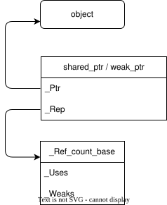
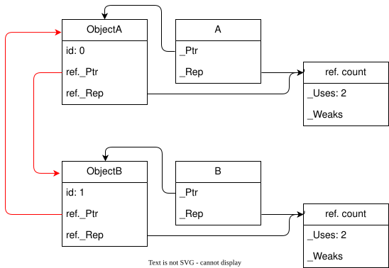

## 引用计数机制

在 MSVC 的实现中，除 `unique_ptr` 外的智能指针都继承自 `_Ptr_base` 这个类：

```cpp
template <class _Ty>
class _Ptr_base { // base class for shared_ptr and weak_ptr
// ...
private:
    element_type* _Ptr{nullptr};
    _Ref_count_base* _Rep{nullptr};
};
```

其中，`_Ptr` 即托管的原始指针，`_Rep` 则是引用计数控制块，其定义如下：

```cpp
class __declspec(novtable) _Ref_count_base { // common code for reference counting
    // ...
    _Atomic_counter_t _Uses  = 1;
    _Atomic_counter_t _Weaks = 1;
};
```

{.center data-style-background-color="white" data-style-color="black"}

其中，`_Uses` 称为“强引用计数”，表示有多少个 `shared_ptr` 实例共享对同一对象的所有权；`_Weaks` 称为“弱引用计数”，表示有多少个 `weak_ptr` 实例观察同一对象。

构造 `shared_ptr` 实例时，会创建上面的引用计数块。当 `shared_ptr` 实例发生复制时，则调用下面的方法，增加引用计数并与 `_Other` 共享指针和引用计数块：

```cpp
template <class _Ty2>
void _Copy_construct_from(const shared_ptr<_Ty2>& _Other) noexcept {
    // implement shared_ptr's (converting) copy ctor
    _Other._Incref();

    _Ptr = _Other._Ptr;
    _Rep = _Other._Rep;
}
```

## 循环引用问题

由于 `shared_ptr` 通过引用计数来管理资源的释放，因此当两个或多个对象相互持有 `shared_ptr` 时，就会导致循环引用问题，进而引发内存泄漏。例如：

```cpp
#include <atomic>
#include <iostream>
#include <memory>

struct Foo
{
    static std::atomic_int counter;
    int id;
    std::shared_ptr<Foo> ref;
    Foo() : id(counter++)
    {
        std::cout << "Object " << id << " created" << std::endl;
    };
    ~Foo()
    {
        std::cout << "Object " << id << " destroyed" << std::endl;
    }
};

std::atomic_int Foo::counter = 0;

int main (int argc, char *argv[]) {
    auto A = std::make_shared<Foo>();
    auto B = std::make_shared<Foo>();
    B->ref = A;
    A->ref = B;
    return 0;
}
```

运行上述代码，我们会发现两个实例的析构函数并没有被调用：

```plain
Object 0 created
Object 1 created
```

在创建 `A` 和 `B` 并相互引用后，此时对象之间的引用关系如下（注意区分智能指针对象本身以及智能指针所引用的匿名对象）：

{.center data-style-background-color="white" data-style-color="black"}

`A` 和 `B` 在作用域结束销毁时，分别将引用控制块中的 `_Uses` 计数减一，但并未归零，因此析构函数不会被调用。
`A` 与 `B` 析构时正确的释放了其持有的引用计数，而相互引用彼此的 `ObjectA` 和 `ObjectB` 则出现了一个自我指涉（self-reference）的圈：要释放 `ObjectA`，必须先释放 `ObjectB`，而要释放 `ObjectB`，又必须先释放 `ObjectA`。对于这个圈中的任何一方而言，其必须释放其自身。从表面上看，要想解决这个问题，只需要将其中一方的 `_Uses` 减 1 即可打破这个圈。

我们考虑地更深入一些，`shared_ptr` 从本质上讲，是将自己的生命周期管理托付给其他实体，也就是所有权的出让。隐含在所有权出让中的还有一种“主从关系”，请考虑这样几个现实的例子：

- 公司的老板 B 与员工 A 关系，B 可以解雇 A，但 A 不能解雇 B。
- 恐怖分子 B 与人质 A 关系，B 可以处决 A，但 A 不能处决 B。

由于上述主从关系的存在，`B->ref = A;`{.language-cpp} 后，`ObjectA` 的生命周期控制权出让给了 `ObjectB`，即 `ObjectB` 是“主”，`ObjectA` 是“从”，后续的 `A->ref = B;`{.language-cpp} 则违反了上述主从关系。所以，更直白地讲，主从关系从本质上就是一种权限等级的划分，在同一关系（如例子中生命周期控制关系）下，低权限的实体不允许反过来控制高权限实体。

## 主从关系的弱化

我们要判断一个对象的“死活”状态，并不非得要拥有对其生命周期的控制权。在这种理念下，出现了 `weak_ptr`，这种指针实际上是对上述主从关系（权限）的一种弱化，其目的不在于控制对象的生命周期，而只是 **观察** 对象是否还有效。因此，`weak_ptr` 并不拥有对象的所有权，也不负责对象的销毁。在必要时，`weak_ptr` 可以通过 `lock` 实现权限的提升，拥有对象的所有权。

那么，`_Weaks` 计数存在的意义何在呢？从编程角度看，`__Ptr_base` 中，`_Rep` 本质上也是一个裸指针，其目的在于让各个智能指针统一使用一份引用控制块。引用控制块本身自然也需要自动析构。从实体权限的角度看，`_Uses` 标记了有多少实体拥有对象的所有权，而 `_Weaks` 则标记了有多少实体在观察该对象（`shared_ptr` 当然也有观察的权限）。只有当 `_Uses` 和 `_Weaks` 都归零时，引用控制块才会被销毁。

## 简易实现

要实现 `shared_ptr` 和 `weak_ptr`，我们需要定义一个引用控制块类，其中包含 `Uses` 和 `Weaks` 计数器。`shared_ptr` 和 `weak_ptr` 共享同一个引用控制块。由于智能指针的构造可能在任意时刻发生，因此对引用计数的修改必须是线程安全的，这就需要使用原子操作来更新计数器。创建引用计数块意味着相应的智能指针已经托管了一个对象，因此 `Uses` 和 `Weaks` 的初始值都应该设置为 1。

```cpp
struct RefCount {
    std::atomic<std::size_t> Uses{ 1 };
    std::atomic<std::size_t> Weaks{ 1 };
};
```

接下来，我们需要定义 `shared_ptr` 和 `weak_ptr` 类，并实现它们的构造、析构、复制和移动操作。在 `shared_ptr` 的析构函数中，我们需要检查 `Uses` 计数器，如果它归零了，就销毁托管的对象，并将 `Weaks` 计数器减一；如果 `Weaks` 计数器也归零了，就销毁引用控制块。在 `weak_ptr` 的析构函数中，我们只需要将 `Weaks` 计数器减一，如果它归零了，并且 `Uses` 计数器也归零了，就销毁引用控制块。由于我们不需要保证计数器的修改与其他内存操作之间的顺序关系，因此在增减计数器时，内存序选用 `std::memory_order_relaxed`。

```cpp
template <typename ElementType, typename DeleterType = std::default_delete<ElementType>>
class ptr_base {
private:
    ElementType* ptr{ nullptr };
    RefCount* ref_count{ nullptr };
public:
    ptr_base() = default;
    explicit ptr_base(ElementType* p) : ptr(p), ref_count(new RefCount()) {}
    ptr_base(const ptr_base& other) : ptr(other.ptr), ref_count(other.ref_count) {}
    ptr_base(ptr_base&& other) noexcept {
        swap(other);
    }
    virtual ~ptr_base() noexcept = default;
    virtual void swap(ptr_base& other) noexcept {
        std::swap(ptr, other.ptr);
        std::swap(ref_count, other.ref_count);
    }
    auto& operator=(shared_ptr other) noexcept { // copy-and-swap idiom
        swap(other);
        return *this;
    }
    operator bool() const noexcept {
        return ptr != nullptr;
    }
    ElementType& operator*() const noexcept {
        return ptr;
    }
    ElementType* operator->() const noexcept {
        return ptr;
    }
};

template <typename ElementType, typename DeleterType = std::default_delete<ElementType>>
class shared_ptr : public ptr_base<ElementType, DeleterType> {
public:
    shared_ptr() = default;
    explicit shared_ptr(ElementType* p) : ptr_base(p) {}
    shared_ptr(const shared_ptr& other) : ptr_base(other) {
        if (this->ref_count) {
            // other 在拷贝过程中一直有效，因此 ref_count 也一直有效，可以直接修改计数器
            this->ref_count->Uses.fetch_add(1, std::memory_order_relaxed);
            this->ref_count->Weaks.fetch_add(1, std::memory_order_relaxed);
        }
    }
    shared_ptr(shared_ptr&& other) noexcept : ptr_base(std::move(other)) {}
    virtual ~shared_ptr() noexcept {
        if (this->ref_count) {
            // 读取、减 1、写回（Read-Modify-Write, RMW），三个步骤必须是原子的
            // 其他线程写入的结果必须立即对当前线程可见，必须具备 acquire 语义
            // 当前线程的写入必须立即对其他线程可见，必须具备 release 语义
            if (this->ref_count->Uses.fetch_sub(1, std::memory_order_acq_rel) == 1) {
                delete this->ptr;
                if (this->ref_count->Weaks.fetch_sub(1, std::memory_order_acq_rel) == 1) {
                    delete this->ref_count;
                }
            }
        }
    }
};

template <typename ElementType, typename DeleterType = std::default_delete<ElementType>>
class weak_ptr : public ptr_base<ElementType, DeleterType> {
public:
    weak_ptr() = default;
    weak_ptr(const shared_ptr<ElementType, DeleterType>& other) : ptr_base(other) {
        if (this->ref_count) {
            this->ref_count->Weaks.fetch_add(1, std::memory_order_relaxed);
        }
    }
    weak_ptr(const weak_ptr& other) : ptr_base(other) {
        if (this->ref_count) {
            this->ref_count->Weaks.fetch_add(1, std::memory_order_relaxed);
        }
    }
    weak_ptr(weak_ptr&& other) noexcept : ptr_base(std::move(other)) {}
    virtual ~weak_ptr() noexcept {
        if (this->ref_count) {
            if (this->ref_count->Weaks.fetch_sub(1, std::memory_order_acq_rel) == 1) {
                if (this->ref_count->Uses.load(std::memory_order_acquire) == 0) {
                    delete this->ref_count;
                }
            }
        }
    }
}
```
