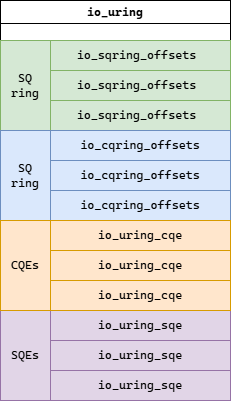

## 概述

Proactor 是 I/O 多路复用的另一种实现方式。在 Reactor 模式中，内核将就绪的事件通知上层应用，应用得知事件就绪后，需要根据具体的事件类型再次发起收发数据的系统调用。在这个过程中，涉及多次内核态和用户态之间的数据移动操作，产生了额外的系统调用和数据移动开销。一种更高效的方案是直接由内核负责将数据定向到用户态的地址空间，避免多余的系统调用和数据拷贝。数据操作完成后，内核将操作完成的事件告知用户态，因此在 Proactor 模式中，用户态收到的是操作完成的事件。处理事件的整个过程是由内核完成的，用户态进程只需要通过系统调用注册需要处理的事件类型（接受请求、收发数据），随后就可以转而处理其他事项。整个过程中，数据操作的发起和数据操作的完成是异步进行的。

Windows 很早就支持了异步 I/O 多路复用，而 Linux 直到 2019 年 `io_uring` 的加入才提供了异步 I/O 多路复用的支持。Windows NT 的 I/O 框架的设计本身就同时考虑了同步 I/O 和异步 I/O [^overlapped-io]，因此在 Windows平台下，天然就有 同步 I/O 接口（如`ReadFile` / `WriteFile`）和异步 I/O 接口（如  `ReadFileEx` / `WriteFileEx` ）可用。

[^overlapped-io]: 在 Windows 平台下，异步 I/O 又被称为重叠 I/O （overlapped I/O）。可参考 [Synchronization and Overlapped Input and Output](https://learn.microsoft.com/en-us/windows/win32/sync/synchronization-and-overlapped-input-and-output)。

根据 Windows 的设计，要实现异步 I/O，需要实现如下机制：

- 独立的 I/O 请求对象：用户发起异步 I/O 操作时，本质上是在向内核“投递” I/O 请求，内核执行 I/O 操作时，需要知道所要操作的文件对象、用户提供的缓冲区、I/O 请求当前的状态等信息；
- I/O 请求的异步执行：将请求对象派发至驱动层执行，在此期间需要考虑如何调度这些新的请求；
- 事件通告机制：操作完成后，告知用户完成事件。

Windows 内部提供了三种异步方案：

- 事件信号：用户可以主动地发起对异步 I/O 事件信号状态的查询（`WaitForSingleObject` / `GetOverlappedResult`）。
- 异步过程调用（asynchronous procedure call）：`ReadFileEx` / `WriteFileEx` 这类异步 I/O 调用执行时，内核会在线程的 APC 队列中创建一个 APC 对象（本质是函数包装器），并在线程陷入内核态时检查 APC 队列状态，并将排队的 APC 构造为线程用户栈中的函数调用现场，这样，在线程返回用户态后可通过执行插入的异步过程调用获知 I/O 处理状态。
- I/O 完成端口（I/O Completion Port, abbr. IOCP）：内核维护了 I/O 完成队列，完成事件以完成包的形式存在。完成队列通过 I/O 完成端口 暴露给用户进程，用户进程仍然以普通的 I/O API 发起 I/O 操作，随后通过 IOCP API 从队列中取出完成包获知 I/O 操作完成事件。

Linux 在早期并充分考虑提供异步 I/O 的支持，这一点从 API 层面也能看出，`read`、`write` 等都是同步的 I/O 操作，并不存在异步事件的通告机制。因此，一直以来，要想在 Linux 中提供真正的异步 I/O 支持，就等同于到重新设计并实现内核的 I/O 处理框架。在早期的 Linux 内核版本，异步 I/O 的实现依赖于线程池，而其本质仅仅是将 `read` / `write` 这类同步操作放到线程池中执行，并没有从根本上解决冗余系统调用和数据拷贝的问题。

## `io_uring`

### 概览

io_uring 在 Linux 5.1 内核中引入，实现了真正的异步 I/O。uring 中的 “u” 是指 user，ring 指环形缓冲区。io_uring 定义了如下概念：

- 提交队列（Submission Queue, abbr. SQ）：用户用过提交 I/O 请求的方式将 I/O 请求对象添加到提交队列中，由内核负责完成 I/O 操作。提交的 I/O 请求对应于 SQ 中的表项，即 SQE（Submission Queue Entry）。
- 完成队列（Completion Queue, abbr. CQ）：内核完成 I/O 操作后，将完成的请求添加到完成队列中供用户获取。完成的结果对应于 CQ 中的表项，即 CQE（Completion Queue Entry）。

io_uring 的设计类似于生产者-消费者模型，其中，SQ 和 CQ 都是环形缓冲区，为了减少系统调用次数和冗余拷贝，两个队列都采用无锁队列实现，通过 `mmap` 映射到用户空间，由用户态和内核态共享。

{.center}

:::{.callout-important}
**异步 I/O 多路复用采用的生产者-消费者模型**

io_uring 的两个环形缓冲区都采用了单生产者-单消费者（single-producer / single-consumer, abbr. SPSC）设计，仅对于当前进程可见。SPSC 所带来的好处是可以极大简化无锁队列的实现，仅需使用简单的内存屏障即可确保线程安全。需要指出的是，SPSC 是针对其中一个环形缓冲区而言的。也就是说，可以创建用户线程 A 向 SQ 生产，内核负责从 SQ 消费；创建线程 B 从 CQ 消费，内核负责向 CQ 生产。

Windows IOCP 则采用了不同的设计。用户进程仍然通过普通的 I/O API 发起 I/O 操作。创建 IOCP 创建后，可以在任意线程中获取 I/O 完成包。因此对于发起请求而言，采用的是 MPSC 模型；对于完成请求而言，采用的是 SPMC 模型。
:::

### 系统调用

io_uring 在内核层面提供了三个系统调用：

- `io_uring_setup`：创建 io_uring 对象，分配 SQ 和 CQ。
- `io_uring_register`：将资源与 io_uring 资源。
- `io_uring_enter`：将 SQE 提交到 SQ 中。

调用 `io_uring_setup` 会在内核中创建 io_uring 对象，并返回文件描述符。此时的 io_uring 对象仍然处在内核态，需要在用户态连续调用三个 `mmap` 将 SQ 和 CQ 映射到用户空间。

```cpp
int io_uring_fd = io_uring_setup(entries, &params);

// 1. Map the Submission Queue ring (head, tail, flags, etc.)
void *sq_ring = mmap(0, params.sq_off.array + params.sq_entries * sizeof(__u32),
                     PROT_READ | PROT_WRITE, MAP_SHARED, io_uring_fd,
                     IORING_OFF_SQ_RING);

// 2. Map the SQE array (the actual submission queue entries)
void *sqes = mmap(0, params.sq_entries * sizeof(struct io_uring_sqe),
                  PROT_READ | PROT_WRITE, MAP_SHARED, io_uring_fd,
                  IORING_OFF_SQES);

// 3. Map the Completion Queue ring (head, tail, overflow, CQEs)
void *cq_ring = mmap(0, params.cq_off.cqes + params.cq_entries * sizeof(struct io_uring_cqe),
                     PROT_READ | PROT_WRITE, MAP_SHARED, io_uring_fd,
                     IORING_OFF_CQ_RING);
```

:::{.callout-important}
**创建的 io_uring 只含 SQ 和 CQ 两个队列，为何需要三次 `mmap`？**

`mmap` 中涉及到三个不同的偏移：

|偏移|含义|
|:-:|:-:|
|`IORING_OFF_SQ_RING`|SQ 的元信息偏移量|
|`IORING_OFF_SQES`|SQE 元组组的实际存储位置偏移量|
|`IORING_OFF_CQ_RING`|CQ 元信息及 CQE 元组的偏移量|

在内核中，io_uring 对象的布局情况大致如下：

{.center}

SQ 和 CQ 的索引和实际数据是分开存储的。SQ 实际数据置于结构末尾的原因在于 SQE 很大（64 字节），若将其存储在紧靠 SQ 的位置，受限于 SQ 索引必须连续存储的特性，整个队列将占用过多的连续内存页。
:::

### liburing

由于 io_uring 系统调用接口过于原始，io_uring 作者 Jens Axboe 在系统调用的基础上封装了 [liburing](https://github.com/axboe/liburing){target="_blank"}。

:::{.callout-note}
对于 Ubuntu 操作系统，需要先执行 `sudo apt-get install liburing-dev`{.language-bash} 安装这个库及其文档（库文档位于第 3 节）。
:::

liburing 简化了 io_uring 使用的流程：

- `io_uring_queue_init_params`：创建并初始化 io_uring。
- `io_uring_get_sqe`：在 SQ 中创建新的 SQE。
- `io_uring_prep_{op}`：针对不同的 IO 操作类型设置指定 SQE 的标志位，`{op}` 支持的操作有 `accept`、`read`、`recv`、`write`、`send` 等。
- `io_uring_submit`：向内核提交 SQE，调用 `io_uring_enter`。
- `io_uring_wait_cqe`：等待一个 CQE 返回并取出，**取出后前移 CQ 头指针**，若当前没有 CQE 返回，则阻塞。
- `io_uring_peek_batch_cqe`：非阻塞检查并获取一批 CQEs，不操作队头指针，如果没有可用 CQE 也立即返回。
- `io_uring_cqe_seen`：将指定的 CQE 标记为已处理。
- `io_uring_cq_advance`：将 CQ 的头指针前移若干个元素，调用前必须执行 `io_uring_cqe_seen` 标记已处理的 CQE。

以接受来自客户端的连接请求为例，用户需要通过 `io_uring_get_sqe` 创建一个 SQE，并调用 `io_uring_prep_accept` 将 SQE 工作模式设定为接受请求，然后通过 `io_uring_submit` 向内核投递请求。在这个过程中，用户可以准备多个 SQEs 然后一次性投递。随后，服务器调用 `io_uring_wait_cqe` / `io_uring_peek_batch_cqe` 等待并检查完成的请求。然后，重复上述投递-等待-检查的流程。

:::{.callout-important}
**liburing 若干注意事项**

- `io_uring_get_sqe` 创建新的 SQE，通过 `io_uring_prep_{op}` 设置工作模式后，须调用 `io_uring_submit` 向内核提交，提交可以批量进行。
- `io_uring_wait_cqe` 的行为是等待并获取队列中第一个可用的 CQE，然后将队指针向前推进一个单位。
- `io_uring_peek_batch_cqe` 非阻塞地获取一批完成的 CQEs，并且不操作队头指针。消费 CQE 后，需要调用 `io_uring_cqe_seen` 将其标记为已处理。该批次的 CQEs 处理完成，需要调用 `io_uring_cq_advance` 将头指针前移指定单位。前移过程中，若遇到未处理的 CQE 则停止。
- 一个 SQE 可能被拆分成多个 I/O 操作，产生多个 CQEs，因此接收 CQEs 的队列一般比 SQEs 的稍大。
:::

下面是一个极简的使用 liburing 批量接收客户端连接请求的例子：

```cpp
#include <arpa/inet.h>
#include <linux/io_uring.h>
#include <netinet/in.h>
#include <sys/socket.h>
#include <cerrno>
#include <cstdint>
#include <vector>
#include <format>
#include <iostream>
#include <stdexcept>
#include <unistd.h>
#include <liburing.h>

struct Event
{
    sockaddr_storage address;
    socklen_t address_length;
    EventType event;

    void clear()
    {
        address_length = sizeof(address);
    }
};

class Server
{
public:
    Server()
    {
        server_fd_ = socket(AF_INET, SOCK_STREAM, 0);
        if (server_fd_ < 0)
        {
            throw std::runtime_error(std::format("failed to create socket, errno: {}", errno));
        }
    }
    void Bind(std::uint16_t port)
    {
        sockaddr_in addr {
            .sin_family = AF_INET,
            .sin_port = htons(port),
            .sin_addr = {
                .s_addr = htonl(INADDR_ANY),
            },
            .sin_zero = {}
        };
        int ret = bind(server_fd_, reinterpret_cast<sockaddr*>(&addr), sizeof(addr));
        if (ret < 0)
        {
            throw std::runtime_error((std::format("failed to bind to port {}, errno: {}", port, errno)));
        }
        port_ = port;
        bound_ = true;
    }
    void Run()
    {
        if (!bound_)
        {
            throw std::runtime_error("server hasn't bound to a port");
        }
        if (listen(server_fd_, SOMAXCONN) < 0)
        {
            throw std::runtime_error(std::format("failed to listen on localhost:{}, errorno: {}", port_, errno));
        }
        io_uring_params params{};
        io_uring ring;
        io_uring_queue_init_params(1024, &ring, &params);

        accept_requests_.resize(backlog_);
        /* prepare to accept `backlog_` requests */

        for (std::uint32_t i = 0; i < backlog_; i++)
        {
            /* get an SQE (Submission Queue Entry) */
            io_uring_sqe* sqe = io_uring_get_sqe(&ring);
            accept_requests_[i].address_length = sizeof(sockaddr_storage);
            io_uring_prep_accept(
                sqe,
                server_fd_,
                reinterpret_cast<sockaddr*>(&accept_requests_[i].address),
                &accept_requests_[i].address_length,
                SOCK_NONBLOCK
            );
            sqe->user_data = reinterpret_cast<std::uintptr_t>(&accept_requests_[i]);
        }

        /* submit accepts */
        io_uring_submit(&ring);

        while (true)
        {
            std::array<io_uring_cqe*, 32> cqes; // IMPORTANT: the kernel may generate multiple CQEs for one SQE
            std::size_t nready = io_uring_peek_batch_cqe(&ring, cqes.data(), cqes.size());
            bool blocked = false;
            if (nready == 0)
            {
                auto err = io_uring_wait_cqe(&ring, &cqes[0]);
                if (err < 0)
                {
                    // error handling, e.g., -EAGAIN
                    continue;
                }
                nready = 1;
                blocked = true;
            }
            for (std::size_t i = 0; i < nready; i++)
            {
                auto& ev = *reinterpret_cast<Event*>(cqes[i]->user_data);
                auto fd = cqes[i]->res;
                HandleEvent(fd, ev);
                if (!blocked)
                {
                    // IMPORTANT: io_uring_wait_cqe already advances
                    io_uring_cqe_seen(&ring, cqes[i]);
                }
                auto sqe = io_uring_get_sqe(&ring);
                if (sqe)
                {
                    ev.clear(); // this reset ev.address_length to sizeof(sockaddr_storage)
                    io_uring_prep_accept(
                        sqe,
                        server_fd_,
                        reinterpret_cast<sockaddr*>(&ev.address),
                        &ev.address_length,
                        SOCK_NONBLOCK
                    );
                }
            }
            if (!blocked)
            {
                // IMPORTANT: io_uring_wait_cqe already advances
                io_uring_cq_advance(&ring, nready);
            }
            io_uring_submit(&ring);
        }
    }
    ~Server() noexcept
    {
        if (server_fd_ > 0)
        {
            close(server_fd_);
        }
    }
private:
    void HandleEvent(int client_fd, Event& e)
    {
        if (client_fd >= 0)
        {
            std::cout << "client fd: " << client_fd << '\n';
            close(client_fd);
        }
        else
        {
        // hanle error
        }
    }
private:
    int server_fd_ = -1;
    std::uint16_t port_ = 0;
    bool bound_ = false;
    const std::uint32_t backlog_ = 16;
    std::vector<Event> accept_requests_;
};

int main(int argc, char* argv[])
{
    try
    {
        Server server;
        server.Bind(8080);
        server.Run();
    }
    catch (std::exception& e)
    {
        std::cout << e.what() << std::endl;
    }
    return 0;
}

```
