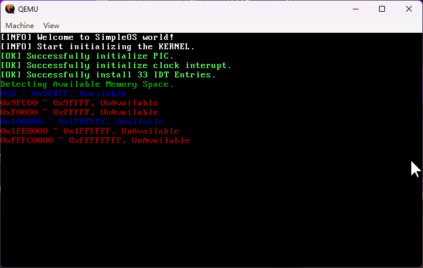

最早的计算机系统只支持单道程序设计，即一次只能运行一个程序。随着计算机技术的发展，出现了 **多道程序设计（Multiprogramming）** ，即允许多个程序在内存中同时存在并交替使用 CPU。这就引入了内存管理的需求：如何将内存划分给不同的程序，如何保护程序之间的内存空间不被互相干扰，以及如何高效地利用内存资源。

访问内存是应用程序最为基础的需求，在只有单道程序的情况下，我们可以固定程序的装入地址，即将程序的可执行代码装入固定的区域 `0x1000 ~ 0x2FFF`，再将运行时所需的全局数据装入另一个固定的区域 `0x3000 ~ 0x3FFF`。在程序运行时，用户程序总是以 `0x3000` 为基址，加上一定的偏移来读/写全局数据。但是，这样的内存管理方案显然无法满足多道程序的需求。我们希望设计这样一种机制，在保持对上述单道程序的兼容性的情况下，允许不同的程序能在固定装入地址的情况下，可被装入到不同的内存区域。这就产生了原始的 **分段内存模型（Segmented Memory Model）** 。

::: {.callout-note}
实际上，要解决装入地址固定的问题，还有另一种 **位置无关代码（Position-Independent Code, PIC）** 的方案，即编译器生成的代码不包含任何绝对地址，而是通过相对地址或寄存器间接寻址来访问内存。这种方案在现代操作系统中非常常见，尤其是在共享库和动态链接的场景下。x86 提供了 `rip` 寄存器相对寻址，使用这种寻址方式时，绝对地址通过当前指令地址 `rip` 加上一个偏移量来计算得到，这样就实现了位置无关代码的功能。本文对此不做过多展开。
:::

Intel 的早期产品 8008/8080 不支持内存分段，后来面向多道程序设计的需求，在 8086 处理器中引入了分段内存模型。在分段内存模型中，内存被划分为多个段（Segment），每个段都有一个段基址（Segment Base）和一个段界限（Segment Limit）。原始的内存地址如 `0x3000` 在这种设计下语义发生了变化，我们称其为段内偏移。程序通过段寄存器（如 `cs`、`ds`、`ss` 等）来指定当前使用的段，并通过偏移地址来访问该段内的内存。这样，不同的程序可以被装入到不同的内存区域，而程序本身仍然使用固定的装入地址进行访问。

然而，分段内存模型存在几个严重问题：

- 段重叠问题：不同程序的段允许重叠，导致内存保护困难。
- 程序编制困难：编制汇编程序时需要手动管理段寄存器，指定访存所要使用的段。使用 C 语言等高级语言编程时，仍需要手动管理段寄存器，平台间的可移植性极差。
- 内存管理问题：由于段的大小不固定，内存分配和回收变得复杂。

除了上述弊病，随着计算机硬件的发展，另一个关键问题也逐渐显现出来。要知道，我们所说的内存，所指的不仅是 RAM 内存条，还包括了 ROM、MMIO 等类型的设备。这些设备通过物理走线，直接映射到 CPU 的地址空间。这些设备虽然都通过内存地址访问，但却并不能当成普通 RAM 内存使用：对 ROM 写入操作是无效的；显卡是典型的 MMIO 设备，将数据写入显存的结果是点亮屏幕上的像素。

::: {.callout-note}
计算机启动后的第一站是 BIOS/UEFI，传统 BIOS 提供了大量的中断服务例程，其中就包含了查询 RAM 内存物理地址分布的例程。以下是一个示例，使用 BIOS 中断 `0x15` 的 `0xE820` 功能来查询内存布局得到的结果，其中非常规的内存区域（如 ROM、MMIO）被标记为不可用（红色），而 RAM 内存区域被标记为可用（绿色）。

{.center}
:::

显然，我们不可能指望应用程序来确定可以装入程序的内存区域，或者说，应用程序需要知道哪些内存区域是 RAM 内存，哪些内存区域是 ROM 内存，哪些内存区域是 MMIO 设备。更何况，不同的处理器平台对于内存地址空间的划分也不尽相同，这就导致了程序编制的困难和平台间的可移植性问题。

为了应对不同平台物理内存布局的不一致性，Intel 在划时代的 i386（Intel 80386）中引入了 **分页内存管理（Paging Memory Management）** 机制，分散的可用物理内存空间被拆分为若干物理页框后由页表统一管理，应用程序始终使用虚拟内存地址访存，MMU 中的地址变换机构根据页表（Page Table）映射计算出虚拟内存对应的真实物理地址，将对虚拟地址的访问转换为对物理内存的访问。

与分页内存管理一同产生的还有 **平坦内存模型（Flat Memory Model）** ，在这种模型中，内存被视为一个连续的地址空间，程序直接使用线性地址进行访问，不再需要通过频繁切换段寄存器来指定段。这样，内存管理变得更加简单和高效，同时也解决了分段内存模型中的诸多问题。

绝大多数操作系统教材详细介绍了内存分页机制，并且提到了分页能够实现用户程序之间的隔离，却对如何做到这一点只字不提。在 x86 CPU 中，顶级页表（或称页目录，Page Directory）的物理页框号（即去除末尾 12 位后的地址）存放在一个名为 `cr3` 的寄存器中，在 32 位环境下，这个寄存器的长度为 32 位，剩余的 12 位用作功能标志位。操作系统通过修改 `cr3` 寄存器（也被称作页目录基址寄存器）的值，可以实现不同用户进程虚拟地址空间的切换。因此，页目录基址寄存器是实现用户进程地址空间隔离的关键枢纽。

::: {.callout-tip}
绝大部分操作系统教材还略去了一个看似不起眼但实际上极为关键的细节：在开启分页之后，CPU 访存所使用的地址均为虚拟地址。然而，操作系统内核必须具备访问页目录、各级页表的能力，试问，操作系统如何通过虚拟内存地址访问到页目录、页表呢？如果不能回答这个问题，操作系统的内存管理就陷入了一个死胡同，要想在分页机制下管理虚拟内存，就要操控页目录、页表，而页目录、页表本身也需要通过内存地址访问，也就是需要经过虚拟地址到物理地址的转换。

解决这个问题的思路非常巧妙，答案是在页目录中添加一个页目录项，其物理页框号设置为页目录自身的物理页框号，这样，CPU 在访问这个页目录项时，经过地址变换后得到的物理地址仍然指向页目录自身。在完成第一级地址变换后，MMU 仍然访问到页目录本身，将其作为普通的页表，其中包含了对各个页表的物理地址映射，进而访问到各个页表（包括页目录自身）。
:::