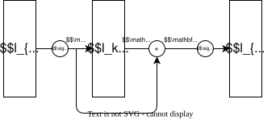

## 背景

越“深”的模型越能够学习到复杂的特征，但是简单的堆砌模型的层数并没有带来模型性能上的提升：

- 梯度消失和梯度爆炸问题使得深层网络难以训练，使用随机初始化和归一化技术后能够一定程度上缓解该问题，训练的模型能够收敛。
- 深层网络会出现退化（degradation）问题，在深度模型收敛后，尝试增加网络的层数会导致在模型在训练集上的精度下降，并且误差增大。按道理来说，引入新的层不应该使模型的训练精度变差，因为我们总是可以把这些新引入的层设置为恒等映射，这样其在训练集上精度应该与原始模型相当，但 SGD 却无法找到这样显然的解。

::: {.callout-important}
退化问题并不是由过拟合引起的。过拟合应表现为在训练集上的精度很高，而在测试集上精度很低。
:::

## 残差学习

{.center width="75%" data-style-background-color="white" data-style-color="black"}