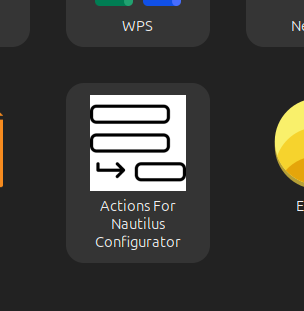
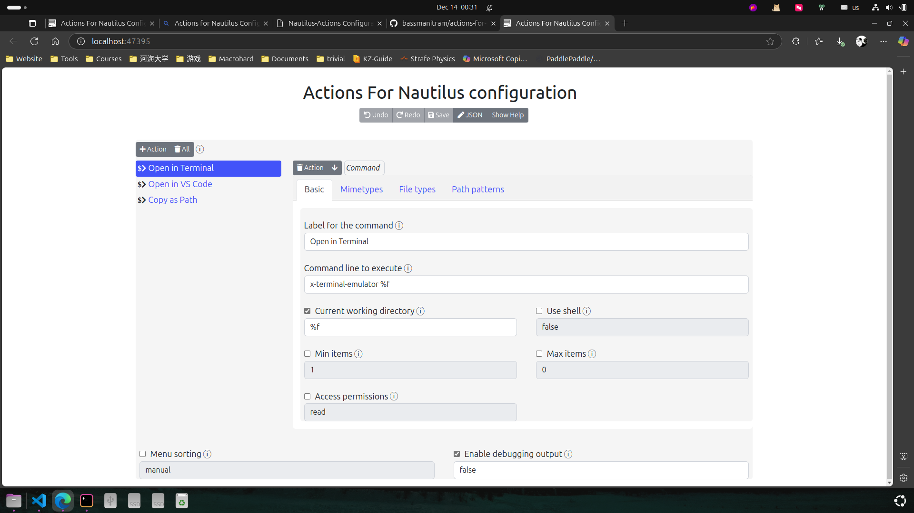
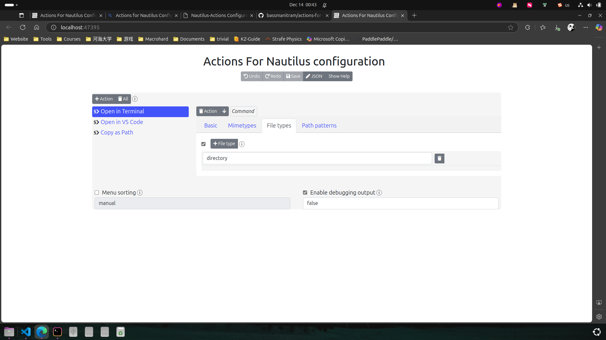
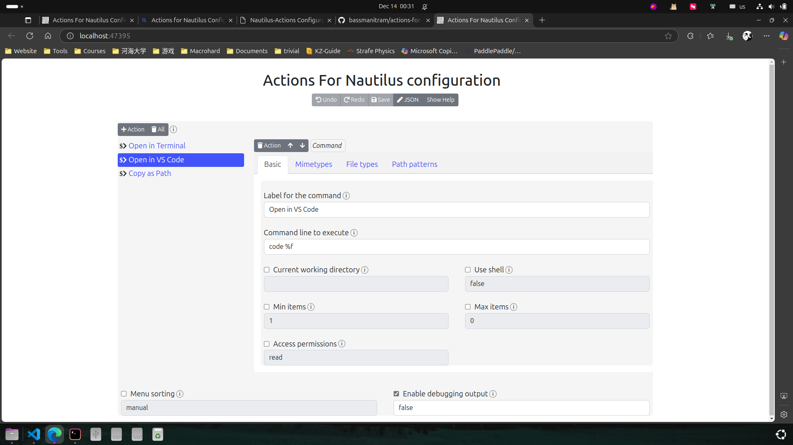
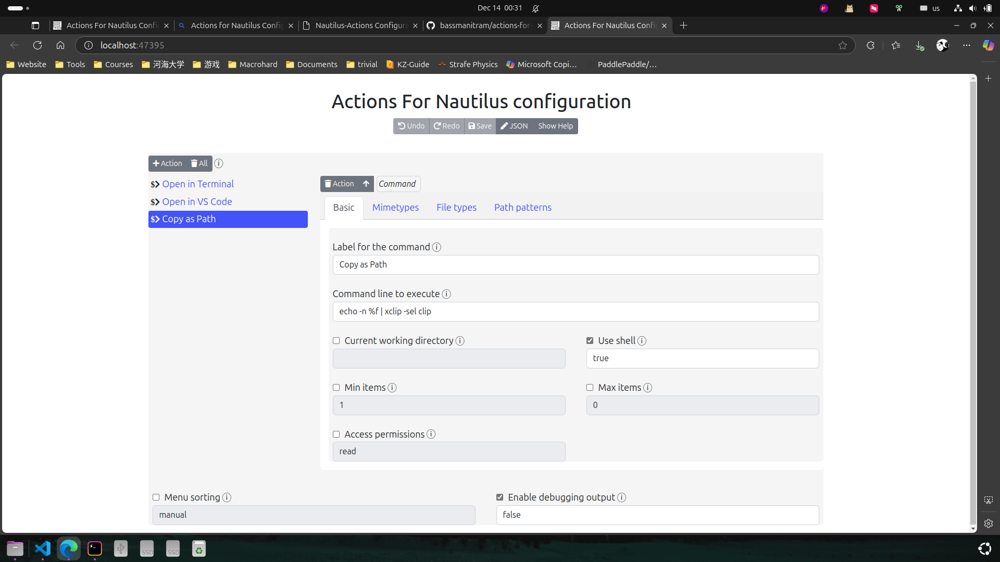
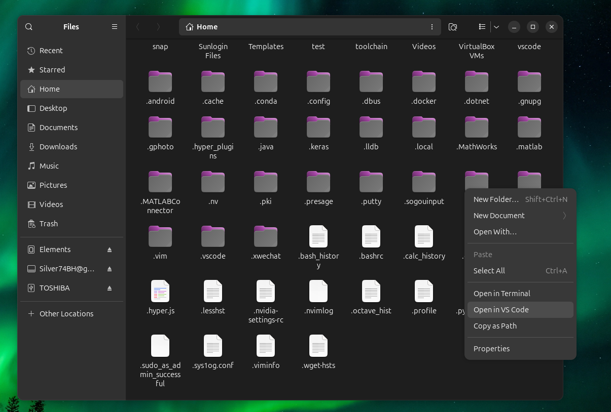
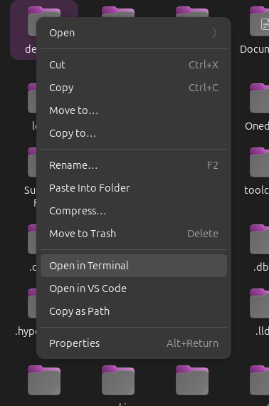
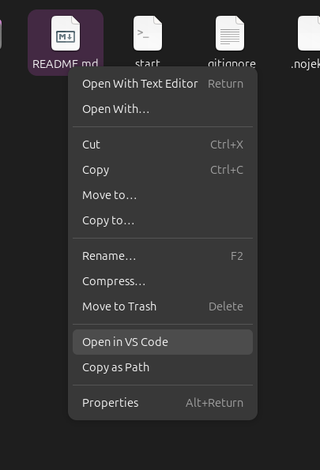

上一篇文章提到，在桌面右键点击“Open in Terminal”能够在终端中直接打开桌面。这个功能和 Windows 11 Explorer 在“终端中打开”的功能非常相像，但是 Windows 11 的该功能不止能打开桌面，而是能够打开任意文件夹。
另外，Windows 11 还允许在 `VS Code` 等其他软件中打开文件夹。

那么，如何在 Ubuntu 中也做到这一点呢？这就需要借助 nautilus（GNOME 默认的文件管理器）插件：Actions for Nautilus Configurator。

## 下载并使用 *Actions for Nautilus*

在 GitHub 下载 [Actions for Nautilus](https://github.com/bassmanitram/actions-for-nautilus) 的 deb 包并安装后，点击图标打开配置页面（配置是通过一个网页完成的）。

参见下图，仿照 Windows 11，我配置了如下选项：

- Open in Terminal：在终端中打开任意文件夹（需要注意将文件类型限定为目录）
- Open in VS Code：在 VS Code 中打开任意文件或文件夹
- Copy as Path：复制任意文件/文件夹的路径

## 效果展示

