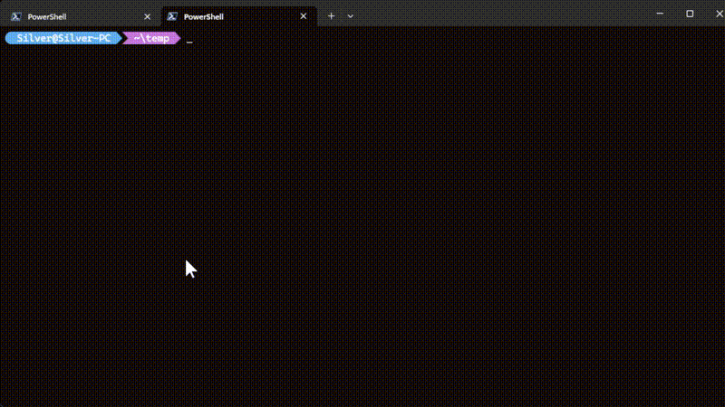

## 问题引出

想要用 Vim 编辑二进制文件，网上一搜即可找到先 `:%!xxd` 后 `:%!xxd -r` 的方法。
然而，在 Windows 平台下，若设置 Neovim 的 shell 环境为 PowerShell（本文使用的是 v7 版本），使用上述方法编辑二进制文件则会碰到下面这样非常怪异的问题：

{.center}

在上面的演示中，先将二进制文件 `hello.exe` 转为十六进制标准格式显示，再转回二进制格式，得到的二进制文件大小居然远大于原来的二进制文件。

我们对比一下 `:%!xxd` 的输出结果和直接在命令行中使用 `xxd hello.exe` 的结果：

{.center}

{.center}

可以看到，在 Neovim 中执行十六进制格式转换和直接在 shell 中执行十六进制格式转换的结果是不一样的。
直接在 shell 中执行得到的结果，根据左侧的偏移量标注，可以确定其大小为 0x00036ff0 + 16，即 225280 字节，这与文件的实际大小完全一致。
因此，在 Neovim 中执行 `:%!xxd` 的结果是错误的。

我们可以尝试如下命令：

```powershell
Get-Content hello.exe | xxd | Select-Object -Last 1
```

{.center}

从这里可以窥见一点端倪，`Get-Content` 默认读取结果与 Neovim 执行 `:%!xxd` 结果相同，这一点绝非巧合。

## 深入挖掘

截至遇到此 bug 时，我使用的 PowerShell 是 7.5 版本，因此管道和重定向这两个操作符是不会污染外部进程通过标准输入传入的二进制数据的 [^pwsh-7.4]。折腾了两天，试了各种方法，都感觉没有从根本上解决问题，遂结合 Vim 手册翻了一下 Neovim 的源代码，基本搞清楚了问题所在。

[^pwsh-7.4]: 参阅 [Using native commands in the pipeline](https://learn.microsoft.com/en-us/powershell/module/microsoft.powershell.core/about/about_pipelines?view=powershell-7.5#using-native-commands-in-the-pipeline){target="_blank"}。

首先，Vim 命令模式与外部程序（如 `xxd.exe`）的交互是借助 shell 完成的，也就是说 `:%!xxd` 这个看似和 shell 没有关系的命令实际仍然先创建了一个 shell 进程，然后再通过 shell 进程执行 `xxd` 这个程序。
`%` 的作用是选中所有行，然后将选中的行传递给 shell。
在这里，传递的方式分两种：

- 临时文件：Neovim 会创建一个临时文件，在 shell 中执行一个读文件的命令获取临时文件的内容作为外部程序；
- 管道：Neovim 将选中的内容作为标准输入传递给 shell，shell 在启动后，会读取标准输入的内容供后续命令或程序使用。

在 Vim 中，可以通过设置 `:set shelltemp`{.language-vim}（使用临时文件，这是默认行为）和 `:set noshelltemp`{.language-vim}（使用管道）来修改传递方式。在 Neovim 中，可通过设置 `vim.o.shelltemp`{.language-lua} 来控制（`true`{.language-lua} 表示使用临时文件，`false`{.language-lua} 表示禁用临时文件）。

通过分析源代码，发现在使用临时文件时是通过调用 `Get-Content` 读取临时文件内容的：

```c
if (itmp != NULL) { 
    xstrlcpy(buf, "& { Get-Content ", len - 1);  // FIXME: should we add "-Encoding utf8"? 
    xstrlcat(buf, itmp, len - 1); 
    xstrlcat(buf, " | & ", len - 1);  // FIXME: add `&` ourself or leave to user? 
    xstrlcat(buf, cmd, len - 1); 
    xstrlcat(buf, " }", len - 1); 
}
```

然而，在 PowerShell 中，`Get-Content` 默认将文件视作文本文件，并使用特定的字符编码读取文件（例如 PowerShell 7 默认采用 UTF-8，对于二进制文件这样需要原样读取的情形应该使用 `-AsByteStream` 选项），这也就解释了上述问题。

那么，采用管道方式传递行不行呢？从 PowerShell 7.4 开始，管道和重定向两个操作符对于外部程序的输入都是二进制安全的。经过若干天的折腾，我采用了如下的配置 [^help-shell-powershell]：

```lua
local shell = "pwsh"

local config = {
	["pwsh"] = function()
        local remove_all_aliases = [[& {Get-Alias | ForEach-Object { Remove-Alias -Force -Name $_.Name }};]]
		vim.o.shellcmdflag = ([[-NoLogo -NoProfile -NonInteractive -ExecutionPolicy RemoteSigned -Command %s]]):format(remove_all_aliases) -- 移除所有 aliases，避免潜在的问题（如 cat 会被视作 Get-Content 的别名）
        vim.o.shelltemp = false -- 不使用临时文件，直接使用管道
		vim.o.shellredir = [[> %s; exit $LastExitCode;]] -- PowerShell 7.4+ 二进制安全
		vim.o.shellpipe  = [[> %s; exit $LastExitCode;]] -- PowerShell 7.4+ 二进制安全
		vim.o.shellquote = ""
		vim.o.shellxquote = ""
	end,
}

if vim.fn.executable(shell) == 1 then -- vim.fn.executable returns 0|1
    if type(config[shell] == "function") then
        vim.o.shell = shell
        config[shell]()
    end
end
```

[^help-shell-powershell]: 可通过 `:h shell-powershell`: 查阅相关帮助，本例配置在帮助文档的基础上修改而来。

## 一个 bug

在折腾的过程中，我还发现了 Neovim 的一个 bug，主要是使用 `shelltemp` 后，PowerShell 的命令的最后一个字符会被截断。例如，`read !cat hello.cpp` 会被截断为 `read !cat hello.cp`。可以通过 `read !cat hello.cpp;` 暂时绕过这个 bug。

目前，已经针对上述 bug 提了 issue，参见 [commands are truncated when using pwsh with `noshelltemp`](https://github.com/neovim/neovim/issues/35304){target="_blank"}。