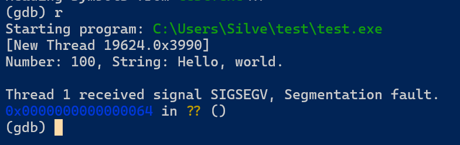

# 应用程序二进制接口

## 背景

在 Windows 或 GNU/Linux 平台下进行汇编、C 语言混合编程期间碰到了很多问题，查阅文档后做一下总结。

造成问题的最主要原因是混淆了 IA-32 和 x86_64 体系结构下的调用约定。32 位平台和 64 位平台分别采用不同的二进制接口规范。IA-32 体系结构下的 C 调用约定等内容并不适用于 x86_64 体系结构下。

## Windows 平台

### Microsoft x64 ABI Conventions

该约定要求函数调用时，前四个参数存放在寄存器中，整型和浮点型分别使用不同的寄存器组传参，然后多出的参数倒序进栈。**这里有一点非常值得注意，通过寄存器传递的参数，调用方必须在栈中也要为其保留相应的位置。**此外，还有如下要求。

> The caller must always allocate sufficient space to store four register parameters, even if the callee doesn't take that many parameters.

这就是说，如果参数不足 4 个，栈中预留的空间也要按照 4 个（及以上）分配。

上面这段官方文档中的原话是针对整型参数传递而言的，当参数列表中包含浮点参数（通过 `xmm` 寄存器传递）时，还要为浮点参数在栈上分配足够的空间。总之，如果参数列表出现了整型参数，那么栈中至少就要为整型参数预留 32 个字节。如果出现了浮点参数，由于前四个浮点参数通过 `xmm` 寄存器传递，栈中就要为浮点参数预留 32 个字节。因此，为寄存器参数预留的栈帧空间大小**至少**是这些值： 0 字节（没有参数）、32 字节（出现整型**异或**浮点型）、64 字节（同时出现整型和浮点型）。

下面这段汇编函数被 C 语言调用，汇编函数 `function` 没有在调用 `printf` 之前为整型参数预留内存空间，在执行过程中出现了 Segmentation Fault（Powershell 中查看 `$?` 的值确定程序是否执行出错），在 GDB 中可以看到段错误消息。通过后续 GDB 调试可以确定，`printf` 执行过程中修改了栈帧上方 32 字节的内存空间，进而导致 `function` 返回地址被篡改，返回到错误的位置造成了段错误。因此，在调用前为寄存器参数预留的空间是绝对必须的。

```Assembly
global function
extern printf
format: db "Number: %d, String: %s", 0x0d, 0x0a, 0x00
function:
  push rbp
  mov rbp, rsp
  sub rsp, 32 ; 将这句注释掉，正常打印字符后出现段错误
  mov r8, rdx ; r8 = lpcStr
  mov rdx, rcx ; rdx = iVal
  lea rcx, [rel format] ; rcx = &format[0]
  call printf
  xor rax, rax
  mov rsp, rbp
  pop rbp
  ret
```

```C
extern void function(int iVal, const char* lpcStr);
int main()
{
  function(100, "Hello");
}
```

```Powershell
# Powershell
nasm function.asm -o function.obj -f elf32
clang function.obj main.c -o main
./main.exe
$? # expected False
```



**另外，还有一点值得注意，在执行 `call` 指令前，`rsp` 寄存器的值必须满足 16 字节边界对齐（16-Byte Alignment）规则。也就是说，执行 `call` 指令前，`rsp` 最后一个十六进制位必须是 `0H`。** `call` 指令执行后，CPU 会替调用方在栈顶压入一个 8 字节的返回地址，然后被调用方会执行堆栈框架的指令，在栈顶保存 `rbp`，然后将 `rbp` 的值设置成此时 `rsp` 的值。于是，进入函数栈帧后，`rsp` 仍然处于 16 字节对齐的状态。遵照此约定，在函数嵌套调用的情况下，可以一直保证进入任何一个函数栈帧后，`rsp` 都是 16 字节边界对齐的。

如果不遵守 16 字节边界对齐原则，在调用函数时同样有可能触发 Segmentation Fault，尤其是在调用像 `printf` 这样的标准库函数时。如果尝试将上述例子中注释掉的 `sub rsp, 32` 修改成 `sub rsp, 40`，即按照 8 字节边界对齐。此时运行程序就会看到，在 `printf` 打印字符之前，程序就直接被操作系统干掉，甚至看不到输出任何一个字符。将这条指令修改成 `sub rsp, 64` 使其满足边界对齐规则，程序又可以正常运行。

综合以上两条原则，在汇编中若要调用函数，要遵循如下格式。

```Assembly
caller:
  ; ...
  ; 假定此时满足 16 字节边界对齐
  sub rsp, k ; k 根据 callee 接收的参数确定，取 0，32，64 三个值
  call callee ; 发起调用，CPU 在栈顶压入 8 字节返回地址
              ; 边界对齐暂时被破坏
  ; ...

callee:
  push rbp ; 栈又回到 16 字节边界对齐的状态
  mov rbp, rsp
  ; ...
  mov rsp, rbp
  pop rbp
  ret
```
## GNU/Linux 平台

### System V ABI

System V ABI 与微软 x64 ABI 类似，前 6 个整型参数通过寄存器传递，前 8 个浮点型参数通过 `xmm` 寄存器传递。具体的规定参见 System V ABI 手册。

不同于微软 x64 调用约定，System V ABI 不要求为寄存器参数在栈中预留空间。但是函数调用 16 字节边界对齐的要求仍然存在，不遵守边界对齐规定在调用系统库函数时仍然会触发段错误。

## 中间文件链接时的问题

todo..

## 另请参阅

[x64 ABI Conventions | Microsoft Learn](https://learn.microsoft.com/en-us/cpp/build/x64-software-conventions)

[System V Application Binary Interface](https://macrohard.fun/docs/x86_64-system-v-abi-0.21.pdf)

