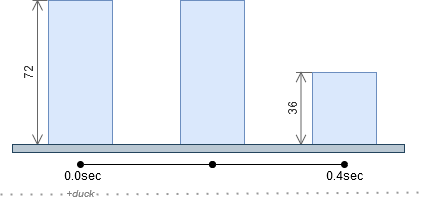
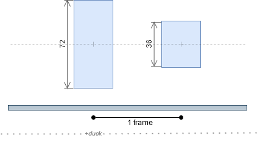
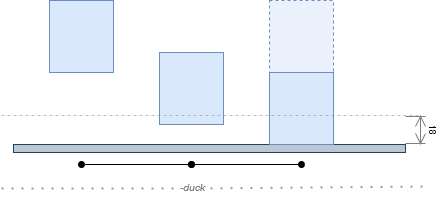
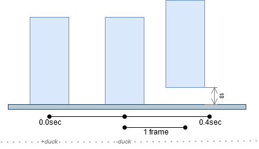
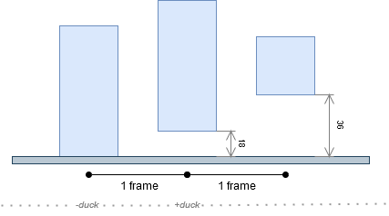

# 译：关于“下蹲”你需要知道的事

## 下蹲（Duck, aka. crouch）

下蹲操作不仅会降低玩家人物模型高度，还会将人物模型的水平速度降低到正常行走速度的 $\frac{1}{3}$。

在 CS 中，人物模型是一个长方体，站立状态的高度为 72 <em>units</em>，下蹲状态的高度为 36 <em>units</em>

### 在平地站立状态下的下蹲过程

- 玩家站立时，人物模型高度为 72 <em>units</em>
- 玩家按下并且保持按下蹲键
- 游戏等待 0.4 秒，0.4 秒之后，人物模型才下蹲，模型高度减少为 36 <em>units</em>

与你玩游戏时看到的现象不同，在你按下蹲键后，过 0.4 秒人物模型才会下蹲。在此期间，游戏引擎仅仅是降低了游戏玩家的视角，人物模型实际并没有蹲下。下蹲过程中，人物模型中心下降 18 <em>units</em>，底部抬升 18 <em>units</em>，顶部降低 18 <em>units</em>，即人物模型相对于地面收缩为原来的一半。

### 在浮空站立状态下的下蹲过程

- 玩家浮空站立状态模型高度为 72 <em>units</em>
- 玩家按下蹲键
- 游戏自动将模型高度减半为 36 <em>units</em>

与平地站立时按下蹲键不同，浮空站立时按下蹲键时，下蹲动作会立即进行。在按下蹲键的下一帧，人物模型保持中心位置不变，人物模型底部抬升 18 <em>units</em>，顶部降低 18 <em>units</em>，即人物模型相对于模型中心收缩为原来的一半。

## 起身（Stand-up）

人物模型处于下蹲状态时，松开蹲键将导致人物模型起身。与蹲下不同，起身操作是立即完成（松开蹲键的下一帧）的。起身时，引擎对人物模型进行碰撞检测，如果起身操作会导致人物模型卡在顶部障碍物中，则引擎不允许人物模型在此处起身。

起身时，人物模型的中心会向上抬升 18 <em>units</em>。

### 小跳（Duck Tap）

如前所述，平地下蹲操作有 0.4 秒的延迟，而起身操作没有延迟。当玩家在按下蹲键后在 0.4 秒内就松开蹲键（即轻击一下蹲键，显然人物模型在这个过程中根本没有蹲下），由于程序员的疏漏，就会发生一件神奇的事情：人物模型会整体向上抬升 18 <em>units</em>，形成伪跳跃的效果，也即<b>小跳</b>。

为了方便地完成小跳，一般将滚轮设置为蹲键的备用按键。

### 小跳蹲（俗称狗跳，Double Duck）

既然小跳过程中人物并没有蹲下，那么就可以参照大跳蹲操作搞出对应的小跳蹲。由于小跳时人物处于浮空状态，因此，小跳过程中按下蹲，人物会立即蹲下（按下蹲键的下一帧），且人物中心位置不变，模型底部抬升 18 <em>units</em>，顶部降低 18 <em>units</em>。于是乎又发生了一件神奇的事情，人物模型相对于地面再次被抬高了 18 <em>units</em>，人物此时高度达到了 36 <em>units</em>。

### 应用场景

仿照大跳和大跳蹲对应的连跳和弹跳，小跳和小跳蹲对应地也有 MCJ （Multi Count Jump）和 MSCJ （Multi Stand-up Count Jump）。

air_accelerate 参数为 10AA 的情况下，手动 MSCJ 很难提速。故平地起地速时基本采用 MCJ。

对于高空加速落下、滑坡出坡等高速场景，无论是 MCJ 还是 MSCJ，手动操作均会减速。这种情况下，由于狗跳滞空时间长于小跳，故减速比 MCJ 更缓慢，因此保持高地速常使用 MSCJ 延长高地速持续时间。

air_accelerate 参数为 100AA 的情况下，手动 MSCJ 提速变得容易很多，并且 MSCJ 拥有滞空时间更长容易操控、不会因滚多次滚轮导致突然降速的优点，因此基本全部采用 MSCJ。

## 为何 MCJ 会突然降速？

MCJ 过程中若一次性滚了多次滚轮（过快的进行下一次小跳），第一次滚滚轮触发小跳后，紧接着快速滚滚轮会与小跳形成小跳蹲，小跳与小跳蹲滞空时间的不同导致原本的 MCJ 节奏被打乱。

## 参考文献

[Ducking · KZ-Guide](https://kzguide.gitlab.io/techniques/ducking/)
