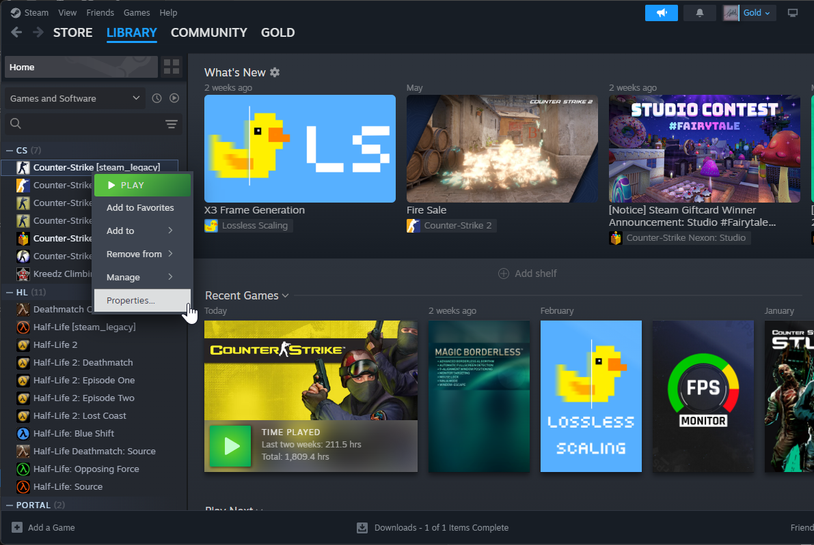
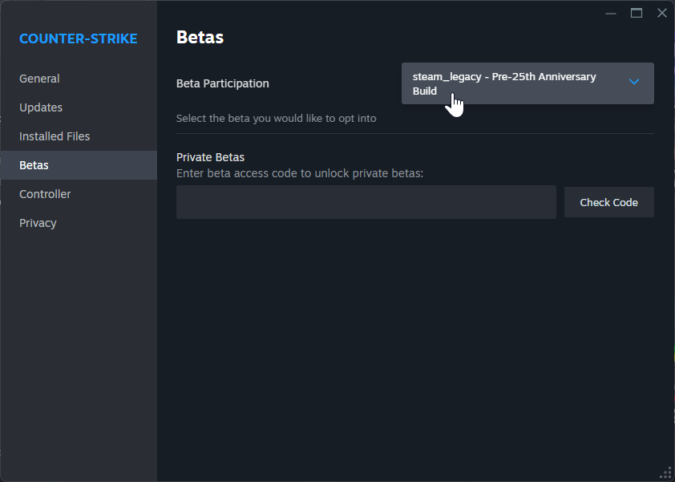
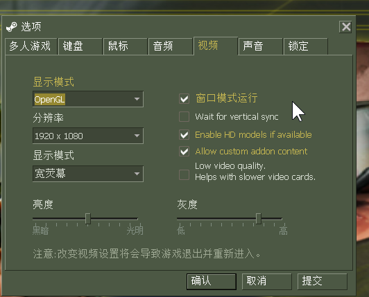
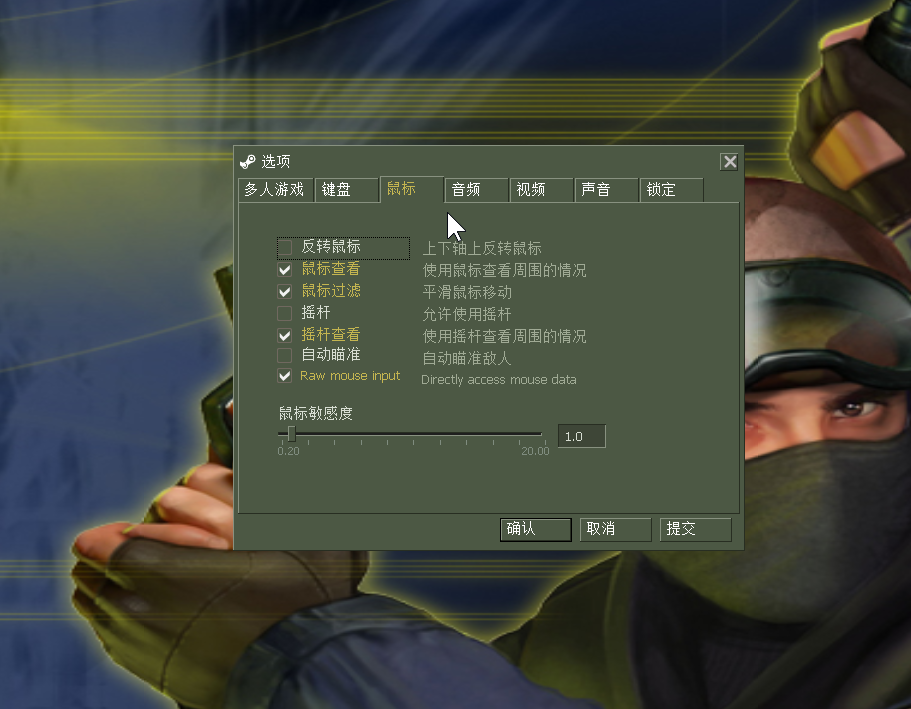

# 准备工作

## CS 版本及插件的选择

正版、盗版 CS 客户端均可使用。总的来说正版体验比盗版好很多，如果选择使用盗版，可能面临如下问题：

- 盗版来路不明，捆绑安装
- 盗版夹带私货，例如客户端启动后直接连接到某某对战游戏平台
- 游戏漏洞带来的体验上的问题（正版 CS 定期推送更新补丁修复游戏漏洞）
- 连接游戏服务器麻烦（正版可以搜索服务器）
- 无法输入中文
- ...

总之，能用正版就用正版。不过，对于刚入坑的玩家，由于对 KZ 各种配置不熟悉，建议先选择使用 Simen 4554 客户端。

选择哪种客户端对于 KZ 练习影响不是特别大，最主要的是选择使用哪种客户端插件。好的插件能够帮助分析自身问题，少走弯路。目前最受好评的是 KZ-Rush 插件，其余插件个人认为功能性不及 KZ-Rush 插件，故不予介绍。

### Simen 4554 客户端（有预装插件，默认配置）

开箱即用的盗版客户端，预装插件（插件较为老旧，功能性不如 KZ-Rush 插件）。

建议刚入门 KZ 时使用该客户端，对 KZ 有一定了解后，再换用其他插件。

<a href='https://macrohard.fun/downloads/2024/06/23/Simen_Cs1.6_4554_Kz_1.2_setup.rar'>Simen 4554 客户端下载链接</a>

### 普通 CS 1.6 客户端（推荐使用 Steam 正版）

推荐购买 Steam 正版 CS 客户端，安装 KZ-Rush 插件。

CS 在 25 周年庆时推送了 25 周年特别版，该版本为目前的默认版本，需要将其切换到 legacy 版本。





## 开始之前

### 调出 CS 控制台

按 `~` 键。

### 控制台命令输入技巧

在控制台中输入命令时会显示相应的命令提示，例如，输入 `fps_max` 时会在下方显示补全提示。使用鼠标可以点选相应补全后的命令，也可以通过 `↑` `↓` 方向键移动选中（默认选中第一个）后，按 `Tab` 键补全。

正版 CS 所有控制台命令：[List of Half-Life console commands and variables](https://developer.valvesoftware.com/wiki/List_of_Half-Life_console_commands_and_variables)

### 关闭垂直同步

控制台命令：`gl_vsync 0`

正版 CS 中也可以通过 `Wait for vertical sync` 选项关闭。



### 原始鼠标输入

控制台命令：`m_rawinput 1`

正版 CS 中也可通过 `Raw mouse input` 选项开启。



### FPS 最大值

控制台命令：`fps_max 101`（也可设置为 `99.5`）

## 插件安装

<a href='https://macrohard.fun/downloads/2024/06/23/lan_server_v4.19.zip'>KZ-Rush 插件下载地址</a>

CS 客户端插件资源文件需存放到 `cstrike` 目录下，对于正版 CS 客户端，其路径为 `<Steam 安装路径>\steamapps\common\Half-Life\cstrike`。

以 KZ-Rush 插件为例，将其解压后，会有下图所示的文件内容。其中，`addons` 是插件文件，`sounds` 是音效文件，`liblist.gam` 是游戏启动后需要加载的模块清单（动态链接库），加载的模块中就包含插件模块 `metamod.dll`。

直接将这些文件移动到 `cstrike` 目录下，替换重复的文件后即可。

上述过程适用于其他任何插件。

## 插件配置

网络上关于插件配置往往都是提供一堆绑定指令让你一个个输进控制台。但是授人以鱼不如授人以渔，与其机械地输入这些命令，不如花些时间了解一下这些命令的含义，在对 KZ 有一定了解之后，熟练使用这些命令会为你带来极大便利。

对于初学者而言，有以下内容需要了解。

### 聊天命令 `say`

命令格式：`say <内容>`

在控制台输入 `say hello`，其效果是在聊天栏输出 `hello`。大部分 KZ 插件功能都是通过该命令调用的。你可以在控制台中输入 `say hello` 以在聊天栏发消息，也可以直接按聊天键（一般全体消息为 `Y` 键，队内消息为 `U` 键，可在设置中自行更改）输入 `hello` 后回车。

### 绑定按键命令 `bind`

命令格式：`bind <"按键"> <"命令、动作、……">`

在控制台输入 `bind "F1" "say hello"`，之后在游戏中按下 `F1` 查看效果。

### 解绑按键命令 `unbind`

命令格式：`unbind <"按键">`

在控制台输入 `unbind "F1"`，在游戏中按下 `F1` 查看效果。

### KZ-Rush 插件定义的命令（常用）

KZ-Rush 定义了大量的命令，这里只介绍常用的。你可以在控制台输入下面的命令，也可以直接按下聊天键，然后直接在聊天栏输入 `say` 后面的内容回车。

>注意：不同的插件，命令不一定通用！

`say /menu`：打开菜单

`say /ljsmenu`：打开长跳设置菜单

`say /cp`：存点（Check Point）

`say /gc`：读点（Go Check）

`say /stuck`：回到最近一次存点

`say /godmode`：上帝模式（摔不死）

`say /weapon`：获取所有武器，或在拥有所有武器的情况下补充武器子弹

`say /speed`：查看速度

`say /key`：显示按键

`say /jof`：显示起跳边距

### 动作

CS 中前进、后退、下蹲、跳跃这些均属于 <b>动作</b> 的范畴。所有的动作均有其对应的控制台命令，例如在控制台输入 `+jump` 你会看到人物往上跳跃（相当于按下跳跃键），再在控制台中输入 `-jump` 解除跳跃键按下状态（相当于跳跃键弹起）。

正版 CS 所有动作对应命令：[List of Half-Life console commands and variables](https://developer.valvesoftware.com/wiki/List_of_Half-Life_console_commands_and_variables)

KZ-Rush 定义了若干特殊的动作命令，其中最为常用的就是 `+hook`（绳索）。一般地，我们使用 `bind "=" "+hook"` 命令将 `=` 键设置为绳索。

### 本人使用的 KZ-Rush 配置（仅供参考）

```bash
bind "F1" "say /menu" # KZ 插件设置菜单
bind "F2" "say /ljsmenu" # 长跳设置菜单
bind "F3" "say /cp" # 存点
bind "F4" "say /gc" # 读点
bind "F5" "say /stuck" # 回点
bind "F6" "say /godmode" # 上帝模式（摔不死）
bind "F7" "say /weapon" # 获取所有武器
bind "F8" "say /dt" # 在控制台显示详细加速信息
bind "F9" "say /key" # 显示按键
bind "=" "+hook" # 绳索
```

### 初次使用 KZ-Rush 注意事项

假定你采用上述配置，进入游戏后，需要按 `F1` 键修改 KZ 插件设置，按 `F2` 修改长跳插件设置。

### 地图包

#### 常用地图包下载

长跳地图包（含 `kz_longjumps2`、`kz_longjumps3` 等长跳练习地图）：<a href='https://macrohard.fun/downloads/2024/06/24/lj_mappack.zip'>下载地址</a>

KZ average 水平地图包：<a href='https://macrohard.fun/downloads/2024/06/24/kz-rush_average_maps_21.03.21.zip'>下载地址</a>

#### 地图包使用方法

解压地图包文件后，将地图包内容复制到  `<Steam 安装路径>\steamapps\common\Half-Life\cstrike` 目录下。

#### 地图包使用方法进阶

上述地图包安装方法容易造成新建游戏菜单中地图数量过多难于查找的问题。对此，正版 CS 可以在  `<Steam 安装路径>\steamapps\common\Half-Life` 目录下创建 `cstrike_addon` 文件夹，将地图包内文件放入 `cstrike_addon`。

然后，在游戏内点选 `allow custom addons` 即可使用地图包，不需要使用地图包时，将选项去掉即可。注意，该过程会造成游戏闪退，重启游戏即可。


## 优化

### 16:9 分辨率 4:3 拉伸优化（针对正版 CS）

<a href='https://macrohard.fun/downloads/2024/06/24/CS.Fixes.zip'>CS Fixes 下载地址</a>

解压后，将 `CS.Fixes.asi` 文件移动到 `<Steam 安装路径>\steamapps\common\Half-Life` 下并重新启动游戏。

GitHub 项目地址：<a href='https://github.com/Garey27/CS_Patches?tab=readme-ov-file'>Garey27/CS_Patches</a>

### 输入法闪退补丁

游戏中会因为输入法导致游戏闪退，其原因是游戏使用旧版本 SDL2 模块存在缓冲区溢出的问题，解决方案是使用新版的 `SDL2.dll` 替换旧版。

使用新版 `SDL2.dll` 后，输入法开启状态下不会闪退，但无法进行移动操作。这时需要将输入法切换为英文，或者开启大写锁定。

<a href='https://macrohard.fun/downloads/2024/06/24/SDL2-2.30.1-win32-x86.zip'>新版 SDL2 模块下载地址</a>

解压后，将 `SDL2.dll` 文件移动到 `<Steam 安装路径>\steamapps\common\Half-Life` （覆盖原文件）下并重新启动游戏。

GitHub 项目地址：<a href='https://github.com/libsdl-org/SDL'>libsdl-org/SDL</a>
