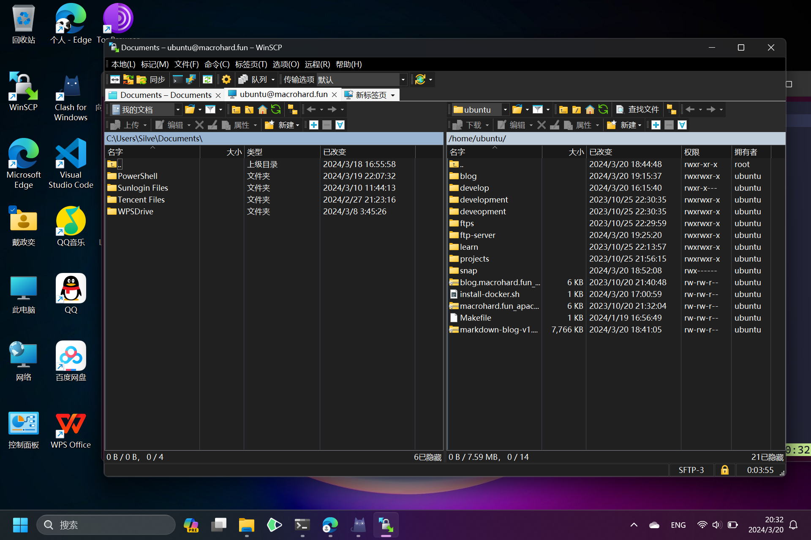

# Markdown 专题

## Markdown 不支持引用语法怎么办？ <a href="#fn01_t" id="fn01_s"><sup>\[1\]</sup></a>

在 Markdown 不支持引用语法的情况下，可以使用如下 HTML 方案代替。

```HTML
<!-- 点击 source 跳转至 target 处 -->
<a id="source" href="#source"><sup>\[1\]</sup></a>
<!-- 点击 target 跳转回 source 处 --> 
<a id="target" href="#source">\[1\]</a> footnote
```



```C++
#include <iostream>
int main()
{
  std::cout << "This is a test code block." << std::endl;
}
```

```Powershell
Write-Host "A Powershell script block."
```

在脚注前留一条横线。

***

<a href="#fn01_s" id="fn01_t">\[1\]</a> 这是脚注。
