# 译：KZ-RUSH 长跳插件数据

这篇文章介绍了在 KZ-Rush 官方服务器及局域网服务器所使用的插件（即 KZ-Rush 插件）长跳数据机制。文中提及的<b>地速（prestrafe）</b>假定您使用 USP、海豹短刀这类基础地速为 250 <em>u/s</em> 的武器。

><b>译注</b>
><br />
><b>地速（prestrafe，简称 pre）</b>：起跳后进行空中加速（strafe）前的地面速度，后文如无特别说明，均将其简称为地速。
><br />
>*u/s*：<em>units/s</em>，CS 中使用的长度单位为 <em>unit</em>，该单位实际上是<em>英寸</em>。CS 为美国开发的游戏，美国惯用英制长度单位。

## 插件中的主要数据及加速数据

让我们以一次成功的 CJ（Count Jump） 上 250 板子为例：

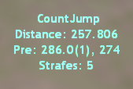

主要数据（main stats）中的第一行是跳跃技巧的名称（图中的 `CountJump`）。在 HJ（High Jump）中，还会显示摩擦帧数 FF（Friction Frames），即所谓的边缘摩擦造成减速的帧数。顺带一提，你可以通过打开 <b>ShowPre</b> 功能（见后文）以在起跳瞬间查看 HJ 的 FF。

><b>译注</b>
><br />
>帧：游戏画面是按照<b>帧（frame）</b>为单位进行刷新和显示的，对人物模型位置、速度等参数的计算也是以帧为单位进行的。
><br />
>边缘摩擦：CS 中引入了高空防坠落保护机制，当玩家距离垂直相对高度超过 70 <em>u</em> 的板子边缘 13 <em>u</em> 左右时会触发该保护机制，该机制被称作<b>边缘摩擦（edge friction）</b>，其作用效果为玩家地速以帧为时间单位逐渐减慢。所谓摩擦帧数即起跳前处于减速状态的时间（以帧为单位）。High Jump（HJ）通过提前起跳的方式规避该减速机制，CJ 等特殊的跳跃方式则不会触发此种保护机制，不需要提前起跳。
><br />

第二行是距离（图中 distance），接下来一行（图中 pre）是按照时间倒序列出的各种地速。在这个 CJ 的例子中，玩家首先进行了一次小跳，然后大跳，因而图中呈现出小跳前地速 274（该地速类型为小跳地速）和大跳前地速 286.0（该地速类型为连跳地速）。另外，括号内还有一个名为 FOG（frames on the ground）的参数，即起跳命令发出之前玩家在地面上滞留的帧数（在 <b>ShowPre</b> 小节中查看关于 FOG 的更多信息）。最后一行（图中 strafes）是加速的次数。

><b>译注</b>
><br />
>小跳和大跳均属于跳跃的范畴，有关小跳的原理参见文章 <a href='https://blog.macrohard.fun/#/kz-guide/about_duck'>译：关于“下蹲”你不知道的事</a>

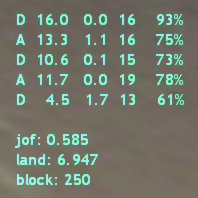

加速数据（strafe stats）的每一列显示对应次数加速的信息。第一列是加速时按下的按键，第二列是加速和失速的差值（即实际获得的加速），第三列是失速的值。第四列是加速按键处于按下状态的帧数，最后一列是加速的效率（efficiency），以百分数表示。

$$efficiency=\frac{加速值为正数的帧数}{本次加速占用的总帧数}$$

><b>译注</b>
><br />
>如前所述，游戏中对跳跃参数的计算是以帧为单位进行的。以上图中第二次加速为例，玩家在按下 A 键进行本次空中加速，本次加速一共持续了 16 帧，这 16 帧中，每一帧都会产生相应的加速值，该值可以为正数（该帧起到了加速效果），可以为 0（没有任何效果），可以为负数（该帧起到了减速效果）。所谓效率，即加速值为正数的帧数在整次加速所占的帧数中的占比。

您可以通过修改设置（在<b>长跳设置菜单</b>中修改，长跳设置菜单的聊天框命令为 `/ljsmenu`）让加速数据第一列展示加速的次数编号，代替默认展示的加速按键。另外，最后一列效率也可以设置为显示<b>按键重叠帧数（overlaps）</b>或<b>不同步帧数（desync）</b>。下面让我们详细讨论这个问题。

<b>Overlaps</b> 是指该次加速开始与上一次加速末尾结束重叠的帧数，即进行本次加速时，有不止一个按键被按下。举个例子，当你本次加速的某一帧按下了 `A` 而上一次加速按下的 `D` 尚未松开，这就会被算作是一次 overlap。如果 overlaps 的值超过 1，就会导致较差的 efficiency。

<b>Desync</b> 是加速过程中鼠标移动方向与加速方向相反的帧数。你应当知道，鼠标的移动会稍微滞后于按键按下，desync 超过 2 也可能是加速效率低下的原因。于是，分析 overlaps 和 desync 这两个参数可以帮助您加速过程中失速的原因。如果这还不够，可以试试一个特别的命令 `/dt`（或 `/detailed`），这条命令会将加速每一帧的加速-失速、按下的按键、鼠标移动方向这些信息输出到控制台中。

在一次成功的跳跃中，加速数据的底端显示以下参数： <b>jof（jumpoff，即起跳点到当前板边的距离）</b>、<b>land（landing，着陆点到超过目标板边的距离）</b>、<b>block（板子的距离）</b>。

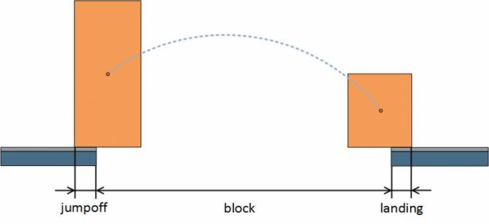

在失败的跳跃中，<b>land</b> 参数被 <b>last</b>（着陆点到目标板边还差多少距离）所取代。

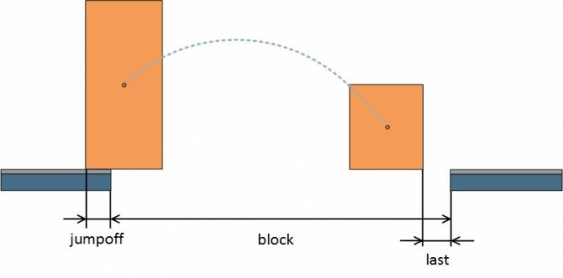

除了 HUD 中的长跳数据，还有一些更详细的信息会输出到控制台中。比如，主要数据中有 <b>maxspeed</b>，即空中滑翔过程中达到的最大水平速度，而加速数据中同时输出加速的次数序号和加速按键，以及 efficiency、overlapps、desync 这三个参数。

><b>译注</b>
><br />
>HUD（Head-Up Display）：电脑屏幕中显示的计分信息。本文中用 HUD 表示在屏幕上显示的 KZ 插件数据，对应地，还有在控制台中显示的 KZ 插件数据。

## 显示地速

起跳时的速度显示有两种模式（参阅下方的<b>长跳设置菜单</b>一节进行设置）。

<b>Pre + Post Speed</b> 模式下，HUD 中还包含地速的类型、FOG 的值、起跳前的速度（在着陆时显示）、起跳后的速度（对连跳和连续小跳均有效）。

<b>Speed + Difference</b> 模式下，您只会看到本次跳跃起跳前的速度以及起跳后损失的速度。

默认设置中，地速有三种颜色。颜色按照以下方式确定：

- 绿色：bhop 时的 FOG 为 1，且没有速度损失（起跳前的速度小于 299.973 <em>u/s</em>）
- 蓝色：bhop 时的 FOG 为 2，其损失速度最小（起跳前速度大于 299.973 <em>u/s</em>）
- 红色：bhop 时有速度损失（其余情况）

><b>译注</b>
><br />
>目前版本的 KZ-Rush 插件绿色表示起跳后没有速度损失；蓝色是指有速度损失，但速度损失最小（FOG 不一定为 2，但损失一定最小）；红色是指有速度损失，且损失不是最小的。详细原因请参考 FOG 一节。
>连续大跳（bhop）：连续的两次大跳称为一次 bhop，通常将其不严谨地称作 <b>连跳（Multi Bhop Jump，MBJ）</b>。
><br />
>连续小跳（Double Duck，DD）：连续的两次小跳称为一次 DD，与 bhop（连续大跳）类似，通常将其不严谨的称作 <b>MCJ（Multi Count Jump）</b>

DD 的颜色显示相较于 bhop 要更简洁明了：FOG 为 2 时是绿色，FOG 为 3 及以上时是红色（CS 中没有 FOG 为 1 的 DD）。其余的地速类型颜色为白色。所有的地速（特指 bhop 或 DD 的地速，即非白色的地速，下同）在控制台中都会有副本。地速与 `/speed`（显示速度）和 `/keys`（显示按键及速度） 聊天框命令开启的速度显示均位于同一栏，因此如果这二者其中之一显示在 HUD 中，地速就会与速度交替闪烁显示。速度和按键的颜色为白色，但如果出现了地速，它们的颜色则会变为地速颜色保持。

## 起跳边距（Jumpoff）

默认情况下只有在起跳时才会显示 jumpoff，但您可以通过聊天命令 `/jumpoff` 或 `/jof` 开启一般情况下的 jumpoff 显示。可通过以配置使得在小跳或从板子上正常掉落时也显示 jumpoff（参阅<b>长跳设置菜单</b>）。如果 jumpoff 的值不超过 5，其在 HUD 中的颜色呈现红色，在 jumpoff 最小时呈现为绿色。注意这里的最小是指在特定情况下 jumpoff 的最小的可能值，在不同的助跑过程中该值不同。举个例子，假定游戏帧率为 100 <em>fps</em>（每秒刷新 100 帧），玩家以 250 <em>u/s</em> 的速度靠近板边。于是，玩家在每一帧中前进 2.5 <em>u</em>。进一步，在玩家要保持不从板子上掉落的前提下，其到板边的最小距离应在 $(0,2.5]$ （单位为 <em>u</em>）范围内，这个最小距离即为本次助跑的最小 jumpoff。

## <b>fuser2</b> 和起跳高度

在进行 BJ 和 CJ 时，滚一下滚轮起跳，且都以最大的无损失地速 299.973 起跳，您是否好奇过为什么这两种情形下 BJ 和 CJ 在跳跃距离上差距如此之大？其关键在于这些跳跃技巧的空中滑翔高度不同，而滑行高度又取决于另一个名为 <b>fuser2</b> 的参数。正常起跳时 <b>fuser2</b> 的值等于 1315，随后在每一帧中减少 10，于是在 1.31 秒之后该值减少为 0。当我们在一块常规的板子上进行连跳时，前后两次起跳时间间隔不到 1.31 秒，因此 <b>fuser2</b> 的值非零，对应的滑翔高度也更少。CJ 的跳跃高度不受此影响，这是因为小跳不改变 <b>fuser2</b>。现在，我们就搞明白了为什么 <b>Up Bhop Jump</b> 和 <b>Drop Bhop Jump</b> 的跳跃距离取决于台阶之间的高低差，以及为什么<b>弹跳（Stand-up Bhop Jump，SBJ）</b>比在常规板子上进行的连跳跳得更高。

><b>译注</b>
><br />
><b>Up Bhop（UBJ）</b> 和 <b>Drop Bhop（DrBJ）</b>分别为 KZ 中向高处的连跳和向低处的连跳。二者的跳跃距离取决于其前后两次起跳的高低差。UBJ 的跳跃距离短于一般的 BJ，而从非常高的地方跳下（有足够的时间等待 <b>fuser2</b> 的值清零）进行的 DrBJ 则可以达到和 <b>Weird Jump（WJ）</b> 同样远的距离。
><br />
>弹跳过程中按下蹲键时，人物模型的高度相对于人物模型中心收缩为原来一半（另请参阅<a href='https://blog.macrohard.fun/#/kz-guide/about_duck'>关于“下蹲”你需要知道的事</a>），导致人物相对于地面的距离提升，导致滞空时间变长。因此，SBJ 的 <b>fuser2</b> 低于 BJ。对于跳图而言，BJ 更短的滞空时间使得玩家在相同时间内能够跨越更多的板子，因而跳图时对于相距不太远的板子通常采用 BJ，而在追求速度的场合下，SBJ 更长的滞空时间能够尽可能地将高空速维持更长的时间。总之，究竟选用 BJ 还是 SBJ 需要结合不同场景具体分析。

在控制台，<b>fuser2</b> 会伴随地速显示。通过 `/fuser2` 命令可以在起跳时将 <b>fuser2</b> 显示在 HUD 中，并在主要数据中显示 <b>fuser2</b>。

另外，相较于 <b>fuser2</b>，您可能更想要得知滑翔高度，这种情况下只要使用命令 `/height`。在起跳时，您将看到预估的高度，而真实的高度会在主要数据中显示（有时由于撞顶高度会更低）。

## Jump Bug 练习器

成功的 Jump Bug 在玩家起身（stand-up）的同时起跳时发生，与此同时人物模型的中心距离地面高度为 36 ~ 38 <em>u</em>（即人物模型双脚离地距离小于 2 <em>u</em>）。此种情况下如果 KZ-Rush 长跳数据中打开 JB 数据显示（参阅<b>长跳设置菜单</b>中的打开菜单），您会看到以下的信息：

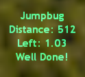

我们可以看到 <b>distance</b>，指示坠落点与着陆点之间的高低差，以及 JB 时人物模型双脚与地面之间的剩余距离 <b>left</b>。如果您打开控制台，会看到这个：

```
[MAIN] JumpBug
Distance: 512.00 units
Left: 1.031250 units
Your Z: -666.968750
Required Z: -668.000000 (+ 2.0)
```

除了 <b>distance</b> 和 <b>left</b>，这里还有一个人物模型在 JB 瞬间的垂直坐标 `Z`（`Your Z`），以及一个高度为 2 <em>u</em> 的范围，在此范围内进行的 JB 才会成功（`Required Z`）。

我们在起身的同时起跳，但是起跳的时机过早或者过晚会发生什么呢？这时就要引出 Jump Bug 练习器。在开关菜单（参阅<b>长跳设置菜单</b>）中打开或设定 `ljs_enable_jumpbug 2` 可以启用该功能。有了练习器，我们可以查看失败的 JB 数据：

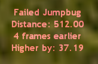

数据表明，我们提前了 4 帧，即比成功的 JB 提前了 37.19 <em>u</em> 起跳。控制台中有一个 Z 坐标，所需的范围以及我们能够进行成功 JB 的坐标（`Possible Z`）。

```
[MAIN] Failed Jumpbug
Distance: 512.00
4 frames earlier
Higher by: 37.19
Your Z: -630.808776
Required Z: -668.000000 (+ 2.0)
Possible Z: -666.968750 (4 frames later)
```

由于我们是通过小跳坠落起始平台的，因而上述例子中的 JB 是可能的。但是如果我们通过常规大跳坠落平台，则不可能在这个高度进行 JB：

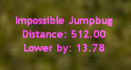

如前所述，控制台中有更详细的信息：

```
[MAIN] Impossible Jumpbug
Distance: 512.00
Lower by: 13.78
Your Z: -681.786621
Required Z: -668.000000 (+ 2.0)
Nearest Z1: -662.833190 (2 frames earlier)
Nearest Z2: -672.269897 (1 frame earlier)
```

在 `Your Z` 及 `Required Z` 旁边还有两个高度距离所需的范围最近：`Nearest Z1` 就在范围的上方，而 `Nearest Z2` 在范围的下方，因而没有适合于完成 JB 的帧。

>译注
>
>始终记住游戏中的位置等各类信息均是以帧为单位进行计算的。

## 聊天命令

```bash
/lj, /ljstats # 打开/关闭主要数据及加速数据
/ljs, /ljmenu, /ljsettings # 长跳设置菜单
/savelj, /saveljsettings # 保存长跳设置
/pre, /showpre # 显示起跳时地速
/jof, /jumpoff # 显示起跳时边距
/colorchat # 打开/关闭长跳数据彩色聊天消息
/ljsound # 打开/关闭长跳数据声音提示
/beam, /ljbeam # 打开/关闭跳跃轨迹
/speed # 显示当前速度
/ljpre # 显示 LJ 起跳地速
/multibhop # 显示连跳每跳的地速
/duck, /ducks, /duckpre, /duckspre # 在 showpre 开启时显示每次小跳的地速
/fuser2 # 显示 fuser2 参数
/height # 起跳时显示起跳高度，并在主数据中显示起跳高度
/ljtop # 打开当日长跳 top 10 榜单（需要 lj_top_enable 1）
/weapontop # 选择 top 10 榜单中的武器速度（需要 ljs_top_weapon_enable 1）
/dt, /detailed # 在控制台中打印跳跃的每一帧详细信息
/ljversion # 长跳数据版本

```

## 长跳设置菜单

在聊天栏输入 `/ljs` 打开长跳设置菜单。

第一页设置：

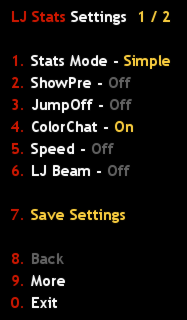

### 1. Stats Mode（默认：Simple）

主要数据及加速数据应该如何显示？

- Advanced：常规数据以及在跳跃的起点和终点高度不同或跳跃未正常结束（接触到传送口、滑坡、水面）时的数据
- Simple：常规数据
- Off：关闭

### 2. ShowPre（默认：关闭）

在起跳时显示哪种速度？

- Speed + Difference：起跳前速度以及起跳后的速度损失
- Pre + Post Speed：FOG 和跳跃前后的速度
- Off：不显示

### 3. JumpOff（默认：关闭）

JumpOff 应该在哪种情况下显示在 HUD 中？

- Jump + Duck + Fall：大跳、小跳、坠落
- Jump + Duck：大跳、小跳
- Jump：大跳
- Off：不显示

### 4. ColorChat（默认：开启）

何种长跳数据消息显示在聊天框？

- On：所有玩家的跳跃
- Only Your Stats：仅显示自己的跳跃
- Off：不显示

### 5. Speed（默认：关闭）

是否在 HUD 中显示当前速度？

- On：是
- Off：否

### 6. LJ Beam（默认：关闭）

绘制跳跃轨迹？

- On：是
- off：否

第二页设置：

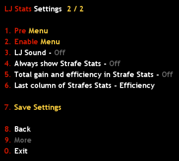

### 1. pre Menu

<b>ShowPre</b> 打开时显示哪些地速：

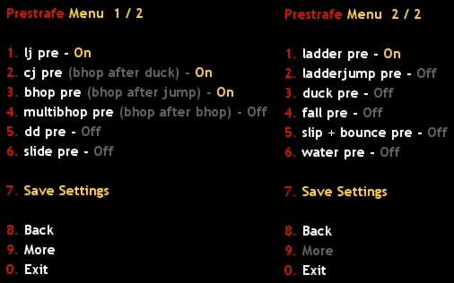

注意，如果您在小跳之前在地面上滞留了超过 10 帧，插件会将其视作小跳地速，若小于这个时长则视作 DD 地速。另外，菜单中的 <b>cj pre</b> 表示大跳而非小跳的地速。

### 2. Enable Menu

选择为哪些技巧显示数据：

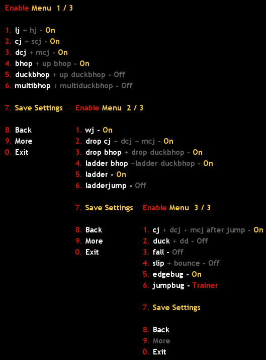

### 3. LJ Sound（默认：关闭）

是否为长跳数据播放音效？

- On：是
- Off：否

### 4. Always show Strafe Stats（默认：关闭)

在什么情况下显示加速数据？

- On：每次跳跃都显示，不论是否有主要数据（如小跳）
- Off：只在有主要数据时显示

### 5. Total gain and efficiency in Strafe Stats（默认：关闭）

是否在加速数据中添加加速综合及平均效率信息？

- On：是
- Off：否

### 6. Last column of Strafe Stats（默认：Efficiency）

加速数据的最后一列显示什么信息？

- Desync：鼠标和按下的键盘按键不同步的帧数
- Overlaps：按下的按键有重叠的帧数
- Efficiency：加速的有效率

## 榜单

默认情况下，局域网服务器的长跳榜单处于关闭状态（`ljs_top_enable 0`），武器速度榜单亦处于关闭状态（`ljs_top_weapon_enable 0`）。如果您开启他们，就可以打开 `/ljtop` 菜单：

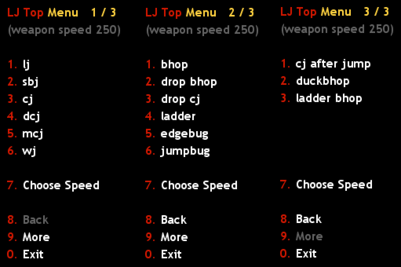

如果武器榜单也打开，菜单中的选项 <b>7. Choose Speed</b> （或聊天命令 `/weapontop`）将会显示选择武器速度的菜单。

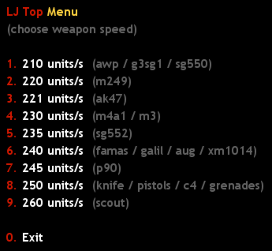

## 长跳配置

除了本文中提及的内容，还有更多的 KZ-Rush 长跳插件<b>常量（cvar）</b>。您可以在文件 `<steam 安装路径>\Half-Life\cstrike\addons\amxmodx\configs\kz_jump_stats.cfg` 中找到他们。有关这些常量的简短描述在另一份同样位于 `configs` 文件夹下的文件 `kz_jump_stats_info[EN].txt` 中。
