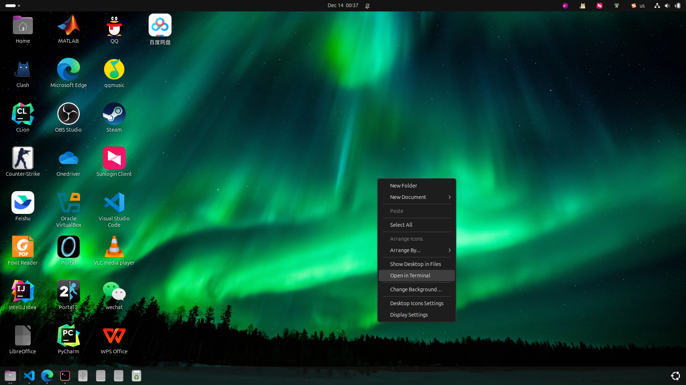
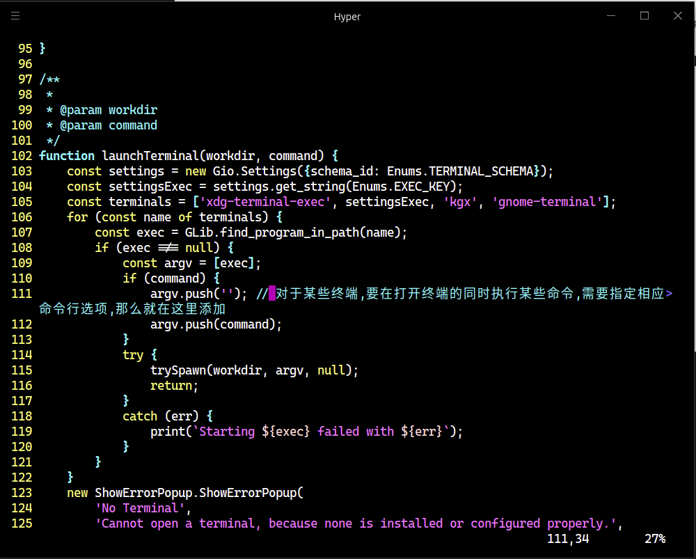
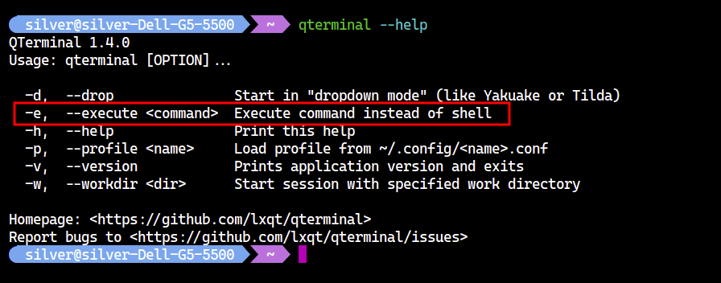
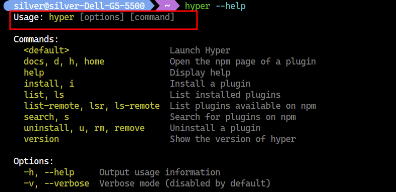

# 怎样完美修改 Ubuntu 的默认终端

本文展示如何将 Ubuntu 默认终端完全地修改为指定终端。

## 修改默认终端模拟器

通过 `update-alternatives` 修改默认的终端模拟器。

```bash
# 请将 hyper 修改为你想使用的默认终端路径
sudo update-alternatives --install /usr/bin/x-terminal-emulator x-terminal-emulator hyper 100
sudo update-alternatives --config x-terminal-emulator
```

此时，通过 `x-terminal-emulator` 命令（本质是一个软链接）就可以打开指定的默认终端。

## 修改 GNOME 的默认打开终端

GNOME 桌面提供了一项非常有用的功能：在桌面上，右键单击，点击“Open in Terminal”就可以在终端中打开指定桌面，这实际上是通过在启动终端的同时执行一条 shell 指令实现的。



但是，在修改默认终端后，很有可能出现无法正常在终端打开桌面的情况。对于 GNOME 桌面，仅仅修改默认终端模拟器是不够的，要想完美变更默认终端，还需要直接修改 GNOME 扩展模块源码。

打开 `/usr/share/gnome-shell/extensions/ding@rastersoft.com/apps/` 目录，按照如下方法修改 `desktopIconUtil.js`。

定位到该文件的如下位置：



上述这段代码的作用是打开默认设置的终端，并将终端的工作目录设置为 `workdir`。其中，`argv.push()` 的作用是向 `argv` 中添加命令行选项，。因此，GNOME 桌面最终在创建终端模拟器进程时，相当于执行这样的 shell 命令：

```bash
# 工作目录 workdir 在创建进程时指定
x-terminal-emulator argv # 将 argv 字符串化后作为命令行参数传递
```

其中 `argv.push(command)` 向 `argv` 添加了 `command`。所以，上面的命令等效于：

```bash
# 工作目录 workdir 在创建进程时指定
x-terminal-emulator command
```

然而，并不是所有的终端模拟器都遵循这样的使用方法。比如，`qterminal` 就不是这样的，它需要在 `command` 前面添加一个 `-e`。



所以，很显然，对于 `qterminal`，我们需要在 `argv.push(command)` 前面再加一行 `argv.push('-e')`，也就是：

```js
argv.push('-e')
argv.push(command)
```

最终相当于执行：

```bash
x-terminal-emulator -e command
```

不过，对于我想要使用的 `Hyper` 终端，就不需要在命令前增加额外的命令行选项。



然后，按下 `Alt` `F2`，输入 `r` 刷新 GNOME 桌面环境。

至此，我对在终端中打开文件夹的功能还不够满意。我想要的效果是像 Windows 11 一样，能够在终端中打开任意的文件夹。而且，除了在终端中打开，Windows 11 还允许在 VS Code 这类软件中方便地打开文件夹，下一篇文章将探讨如何在 Ubuntu 中做到这一点。