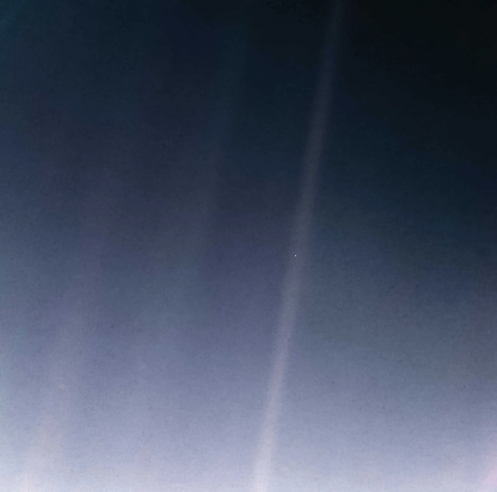

〈逍遙遊〉開篇先談“大小之辯”，由“大小之辯”引出人對於“價值”的追求，動物對於“大小”的比較就像人間對於名利大小的評判。

私以為“至人無己，神人無功，聖人無名”是全篇的核心。宋榮子“舉世而譽之而不加勸，舉世而非之而不加沮”，看淡人間的“榮”與“辱”，能夠分清自我與人間普遍的價值取向，不為人間的價值取向所左右，即達到了“聖人無名”的境界，對於世人所認定的“虛名”，即別人對他的認可與否，宋榮子“未數數然也”。而“功”在本文應該取“用力工作”之意，“福”字面理解則是“順利”，列子對於“順利”“未數數然也”，即順勢而為，凡事不強求，但“順勢而為”任然需要憑藉“勢”，也就是“猶有所待”。“至人”則能夠進入一種“無我之境”，在拋開外界的同時亦能夠忘卻自我，私以為解釋為“忘卻自我對於外物的評判”甚為合理，“天地與我并生，而萬物與我為一”，進而達到超然物外的境地。

反觀自己，從小到大，似乎總是活在別人的價值體系里，總是想要追求別人價值體系中“最好”的狀態，這個過程中，我有所得，也有所失。“所得”可以是別人口頭的褒獎，“所失”可以是別人刻薄的批評。人不可能一輩子都在“得”，亦不會一輩子都在“失”。受到褒獎時，“春風得意馬蹄疾，一日看盡長安花”；受到批評時，好像萬念俱灰，世間一切失去了存在的必要。一直以來，我做一件事，總是存在這樣一種動機，即通過做好一件事來換取一些什麼好處。例如看書，總是想通過看書學得一些知識，進而達到到一種比別人更加“優越”的地步，可這不正是現行教育體系的大棒強加於我們頭上的“評判指標”嗎？每個人都是時代的因果，人塑造了一個時代，時代塑造了每個人。“評判指標”最終無可避免要落到頭上，這是時代強加於於每個人的、不得不嘗的苦果，然而對於個人而言，若“倒果為因”，將評判指標作為自己立足于世界的唯一準繩，則大謬矣。人生究竟有何意義，或者人生有沒有意義，是一個值得思考的問題。一切價值或意義都是人產生的對外物的評判，這種評判反過來又塑造者我們每個人。

我不是聖人，更不可能是神人或是至人。做一件事，只能**盡量**不要老想著從中撈到什麼好處，而要以人純粹的動機出發，這純粹的動機，是人的天性賦予的，亦是人的閱歷所造成的，閱歷本身也是天地萬物所造就的。同時，也不應對別人的生存狀態**過多**地置喙，若要讓每個人都符合自己所認為的“好”的狀態，豈不是對於數數然地去求“功”嗎？

說起來簡單，可是真正想明白卻極為困難。但我想，也不要過於數數然地去強逼自己去達到這樣的狀態，順應自然，一點點地過渡即可。