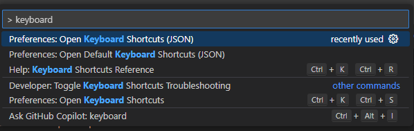
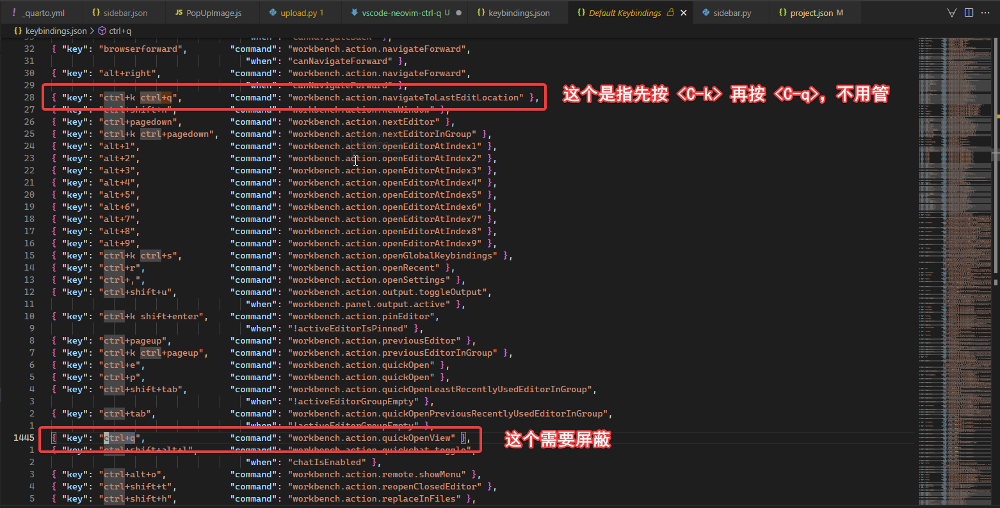
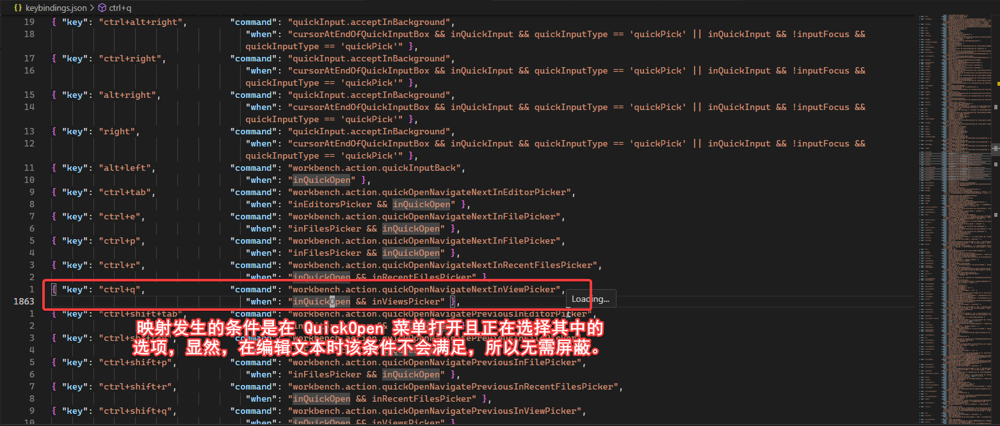

个人比较习惯通过 `<C-q>` 快捷键使用 Vim 的 VISUAL BLOCK 功能，但是 VSCode 安装 vscode-neovim 后在默认情况下按 `<C-q>` 是达不到预期效果的。
在 Windows 下按下此快捷键会唤出一个菜单，在 Linux 下，会关闭 VSCode 窗口。

按下 `<C-p>`，输入 `> keyboard`，分别找到默认的快捷键配置和用户的快捷键配置。



打开默认的快捷键和用户快捷键配置，在默认快捷键配置中搜索 `ctrl+q`，然后在用户快捷键配置中把绑定的功能屏蔽。举例来说：



对于上图来说，屏蔽方式就是在用户的 `keybinding.json` 文件中添加：

```json
[
    // ...
    {
        "key": "ctrl+q",
        "command": "-workbench.action.quickOpenView"
    }
]
```

按照这种方式，在整个默认快捷键配置中搜索 `ctrl+q`，并在用户快捷键配置中进行屏蔽。需要注意，并不是所有包含 `ctrl+q` 的快捷键映射都需要屏蔽。举例来说，像 `ctrl+k ctrl+q` 表示先按 `<C-k>`，再按 `<C-q>`，这是没有必要屏蔽的；另外，`when` 字段表示快捷键映射发生的条件，若在进行编辑时此条件不满足也是不需要屏蔽的。



## Windows 解决方案

```json
[
    // ...
    {
        "key": "ctrl+q",
        "command": "-workbench.action.quickOpenView"
    },
    {
    "key": "ctrl+q",
    "command": "vscode-neovim.send",
    "args": "<C-q>",
    "when": "editorTextFocus && neovim.mode == 'normal'" // 拥有文本输入焦点且当前为 NORMAL 模式才允许此映射
    }
]
```

## Linux 解决方案

## 注意事项

需要在 Neovim 的配置中添加对 `<C-q>` 的映射，将其映射到 VISUAL BLOCK 功能。

```lua
vim.api.nvim_set_keymap ("v", "<C-q>", "<C-v>", { noremap = true, silent = true })
```